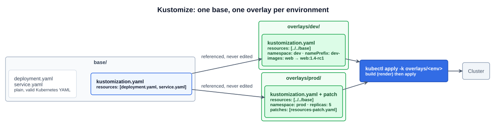
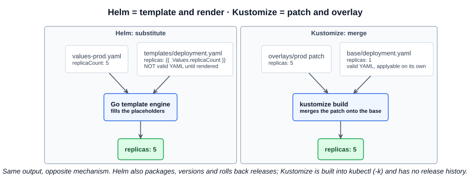

# 22 — Kustomize

> **Kustomize is a standalone tool to customize Kubernetes objects through a kustomization file.** Since **1.14**, kubectl also supports the management of Kubernetes objects using a kustomization file. — [kubernetes.io](https://kubernetes.io/docs/tasks/manage-kubernetes-objects/kustomization/)

The lecture's subtitle is the official one: **declarative management of Kubernetes objects**. You keep ordinary YAML manifests as a **base**, then describe changes on top of them (labels, name prefixes, namespaces, image tags, replica counts, patches) in a file named **`kustomization.yaml`**. Kustomize renders the result; `kubectl` applies it.

Three facts carry most exam questions:

- **It's built into kubectl.** `kubectl apply -k <dir>` and `kubectl kustomize <dir>`. No extra binary is needed (a standalone `kustomize` CLI also exists).
- **It's template-free.** Every input is plain, valid Kubernetes YAML. There are no `{{ placeholders }}`.
- **The layout is base + overlays.** One base, one overlay directory per environment, each with its own `kustomization.yaml`.

The full depth (strategic merge vs JSON 6902 patches, generators, components) is CKAD material. It lives in the [CKAD notes, section 11](https://github.com/caseythecoder90/ckad-exam-prep/tree/main/notes/11-kustomize). The KCNA needs what Kustomize is and how it differs from Helm.

---

## 1. Base and overlays

The lecture's layout:

```
base/                   # Deployment, Service, kustomization.yaml
overlays/dev/           # kustomization.yaml + patches
overlays/prod/          # kustomization.yaml + patches
```



- **Base**: the shared manifests plus a `kustomization.yaml` listing them under `resources:`. It's valid on its own: `kubectl apply -k base/` works.
- **Overlay**: a directory whose `kustomization.yaml` points at the base (`resources: [../../base]`) and adds only what differs for that environment. **The base is never edited.** Overlays reference it.
- You apply the **overlay**, not the base: `kubectl apply -k overlays/prod`.

```yaml
# base/kustomization.yaml
apiVersion: kustomize.config.k8s.io/v1beta1
kind: Kustomization
resources:
  - deployment.yaml
  - service.yaml
```

```yaml
# overlays/prod/kustomization.yaml
apiVersion: kustomize.config.k8s.io/v1beta1
kind: Kustomization
resources:
  - ../../base              # the base is just a directory listed as a resource
namespace: prod             # set on every resource
namePrefix: prod-           # web -> prod-web (references are rewritten to match)
labels:
  - pairs: {env: prod}
images:
  - name: nginx             # matched by IMAGE name
    newTag: "1.27"
replicas:
  - name: web
    count: 5
patches:
  - path: resources-patch.yaml   # a fragment of the Deployment, merged onto the base
```

```yaml
# overlays/prod/resources-patch.yaml (strategic merge: a partial manifest)
apiVersion: apps/v1
kind: Deployment
metadata:
  name: web
spec:
  template:
    spec:
      containers:
        - name: web
          resources:
            limits: {memory: 256Mi}
```

### The common fields

| Field | What it does |
|---|---|
| `resources` | The manifests (or other kustomization directories) to include |
| `namespace` | Sets `metadata.namespace` on every resource |
| `namePrefix` / `nameSuffix` | Renames every resource and updates the references to it |
| `labels` / `commonLabels` | Adds labels (`commonLabels` also writes selectors) |
| `commonAnnotations` | Adds annotations to every resource |
| `images` | Changes an image's name or tag without touching the Deployment |
| `replicas` | Overrides a replica count |
| `patches` | Merges partial manifests (strategic merge) or applies JSON 6902 operations |
| `configMapGenerator` / `secretGenerator` | Builds ConfigMaps and Secrets from files or literals, with a **content-hash suffix** so a change forces a rollout (the `--append-hash` idea from [04-10](../04-kubernetes-fundamentals/10-configmaps.md)) |

---

## 2. The commands

```bash
kubectl kustomize overlays/prod          # render to stdout: see exactly what will be applied
kubectl apply -k overlays/prod           # render + apply
kubectl diff -k overlays/prod            # what would change on the cluster
kubectl delete -k overlays/prod          # render + delete
kubectl version --client                 # also prints the embedded Kustomize version
```

`-k` takes a **directory** containing a `kustomization.yaml`, not a file. `kubectl apply -f` on the same directory would apply the raw manifests and ignore the kustomization.

`kubectl kustomize` also accepts a **Git URL**. Chapter [05-12](12-gateway-api.md) used it to install the Gateway API CRDs straight from a pinned release.

---

## 3. Kustomize vs Helm

The study tips' memory hook: **Helm = template and render, Kustomize = patch and overlay.**



| | **Kustomize** | **Helm** ([05-21](21-helm.md)) |
|---|---|---|
| Mechanism | **Overlay and patch**: merge changes onto a base | **Template and values**: substitute values into placeholders |
| Inputs | Plain, valid Kubernetes YAML | Go templates, not valid YAML until rendered |
| Per-environment config | One **overlay directory** per environment | One **values file** per environment (`-f values-prod.yaml`) |
| Tooling | **Built into kubectl** (`-k`) | Separate `helm` binary |
| Packaging and sharing | None: it's directories of YAML | **Charts**, repositories, OCI registries, Artifact Hub |
| Release lifecycle | None. `apply -k` is fire-and-forget; no history, no rollback | **Releases** with revisions, `upgrade`, `rollback`, `uninstall` |
| Logic | None by design | Conditionals, loops, functions |
| Typical fit | Your own manifests with small per-environment differences | Distributing an application for others to install; third-party software |
| Governance | Kubernetes **SIG CLI** project (`kubernetes-sigs/kustomize`) | **CNCF Graduated** project |

They aren't mutually exclusive. A common pattern is Helm for third-party software and Kustomize for in-house services. GitOps tools such as Argo CD and Flux (section 7) understand both natively.

---

## Exam angle

- **Kustomize customizes plain Kubernetes YAML through a `kustomization.yaml` file.** It's **template-free**, and it's **built into kubectl since v1.14**: `kubectl apply -k <dir>`, `kubectl kustomize <dir>`.
- **Base + overlays:** the base holds the shared manifests, and each environment's overlay references the base and adds patches and transformers. You apply the overlay. The base is never edited.
- **Helm templates; Kustomize patches.** "Which tool renders manifests from templates with a values file?" is Helm. "Which customizes existing YAML with overlays and patches, without templates?" is Kustomize.
- **Distractor:** "Kustomize is a package manager" or "Kustomize can roll back a release". That's Helm. Kustomize has no packages, repositories or release history.
- **Distractor:** "Kustomize needs a separate install." The standalone binary exists, but kubectl embeds it.

## References

- [Declarative Management of Kubernetes Objects Using Kustomize](https://kubernetes.io/docs/tasks/manage-kubernetes-objects/kustomization/) — the official task page: generators, transformers, patches, bases and overlays
- [kubectl kustomize](https://kubernetes.io/docs/reference/kubectl/generated/kubectl_kustomize/) — the built-in render command
- [Kustomize](https://kustomize.io/) — project site
- [kubernetes-sigs/kustomize](https://github.com/kubernetes-sigs/kustomize) — source, standalone releases, and the kubectl version mapping
