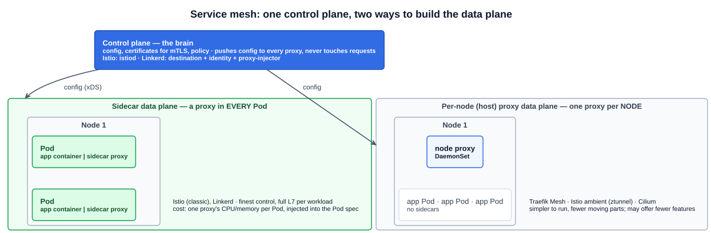
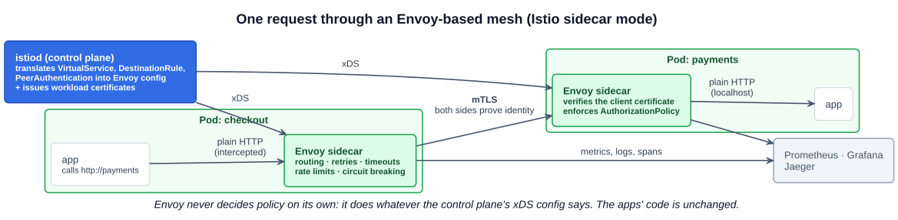

# 23 — Service meshes and Envoy

> **A service mesh is a dedicated infrastructure layer that controls service-to-service communication**, transparently to the application. It handles security (mTLS, access policy), traffic management (routing, retries, timeouts, rate limiting, circuit breaking) and observability (metrics, logs, traces) for every call between services. A mesh has two parts: a **data plane** of proxies that carry the traffic, and a **control plane** that configures them.

The lecture's framing: **a helper for microservices.** Microservices are small, independently deployable units that together form one application ([02-01](../02-cloud-native-architecture/01-monolithic-vs-microservices.md)). Split one application into dozens of services, possibly across hybrid and multi-cloud infrastructure, and the hard part becomes the **network between them**: which calls are allowed, are they encrypted, what happens when one is slow, and where did a request spend its time. A service mesh answers those questions **once, in the infrastructure**, instead of in every service's code.

The study tips list four things to know: **the purpose of a service mesh**, **its main components (proxy and data plane, plus the control plane)**, **the common open source meshes**, and **how Envoy relates to them**.

---

## 1. What a mesh does: the three checks from the lecture

- **Services communicate efficiently, reliably and securely.**
- **It's useful as the scale and complexity of the application grow.** For three services a mesh is overhead. For three hundred it's the only sane way to apply one policy everywhere.
- **The typical architecture is a data plane plus a control plane.**

### Benefits

| Benefit | What it means |
|---|---|
| **Mutual TLS (mTLS)** | **Both** client and server present certificates and verify each other: two-way authentication, plus encryption in transit. Ordinary TLS only proves the **server's** identity. The mesh issues and rotates the certificates automatically |
| **Access control policies** | Allow or deny calls by **service identity** (from the mTLS certificate), method or path: "only `checkout` may call `payments` POST /charge". Layer 7 and identity-based, which NetworkPolicy can't do ([05-10](10-network-policies.md)) |
| **Observability with tracing** | Every hop passes through a proxy, so the mesh can emit spans for distributed traces (section 6) |
| **Monitoring** | Golden metrics for every service without code changes: request rate, error rate, latency |
| **Rate limiting** | Caps how many requests a client may send in a time window, protecting a service from overload |
| **Circuit breaking** | Stops sending requests to an instance that keeps failing or is overloaded, failing fast instead of piling up waiting calls. It "trips" like an electrical breaker and lets traffic through again once the instance recovers. This prevents **cascading failure** |
| **Traffic management** | Retries, timeouts, weighted traffic splitting (canary releases), mirroring, fault injection |

All of this is **transparent to the application**. The app makes a plain HTTP call to `http://payments`, and the proxies do the rest.

---

## 2. Data plane and control plane

| | **Data plane** | **Control plane** |
|---|---|---|
| Role | **The muscle**: every request between services flows through it | **The brain**: a management hub that sits above the proxies, **configuring and directing** them |
| Made of | Proxies (sidecars or per-node proxies) | A small set of services; in Istio a single binary, **istiod** |
| Does | Routing, load balancing, mTLS handshakes, retries, rate limits, telemetry | Turns your mesh resources into proxy config, issues certificates, distributes policy |
| Touches requests? | **Yes** | **No** |

### Two ways to build the data plane

**Sidecar pattern** (the typical one). A proxy container is **injected into every Pod** next to the application container ([04-02](../04-kubernetes-fundamentals/02-pods.md)). Because containers in a Pod share one network namespace, the proxy can intercept all inbound and outbound traffic without the app knowing. Injection is usually automatic: label the namespace, and a **mutating admission webhook** adds the sidecar to each new Pod ([05-16](16-pod-security-admission.md)). **Istio** (classic mode) and **Linkerd** work this way. It gives fine-grained control per workload, but costs one proxy's CPU and memory per Pod.

**Host (node) proxy architecture.** **One proxy per node**, usually a DaemonSet, shared by all the Pods on it. The lecture's example is **Traefik Mesh**. The lecture's trade-off: **simpler to manage, but it might not offer as many features as the sidecar pattern.** The idea has grown since: **Istio ambient mode** (GA in Istio 1.24, November 2024) uses a per-node **ztunnel** for L4 and mTLS, plus optional **waypoint** proxies for L7. **Cilium** runs its mesh in eBPF plus a per-node Envoy.

---

## 3. Envoy: the proxy under most meshes

> **Envoy is an open source edge and service proxy, designed for cloud native applications.** — [envoyproxy.io](https://www.envoyproxy.io/)

If the service mesh is the idea, Envoy is usually **the component moving the packets**.

- Written in **C++**. Created at **Lyft** (open-sourced in 2016), and **CNCF Graduated** in November 2018.
- Built to sit **next to an application**, as a sidecar or at the edge, and to handle **service discovery and load balancing, encryption and authentication, observability (metrics, logs, traces), and traffic shaping** (retries, timeouts, rate limits, circuit breaking).
- **Configured dynamically through the xDS APIs.** A control plane streams configuration to Envoy over gRPC, with no restarts. Each "DS" is a discovery service for one kind of config:

| API | Delivers |
|---|---|
| **LDS** (Listener) | Which ports to listen on and how to handle connections arriving there |
| **RDS** (Route) | HTTP routing rules: host and path matches, weights, retries |
| **CDS** (Cluster) | Upstream services Envoy can send to, with their load-balancing and circuit-breaker settings |
| **EDS** (Endpoint) | The actual IPs and ports behind each cluster (in Kubernetes, from EndpointSlices) |
| **SDS** (Secret) | TLS certificates and keys, which is how mTLS certificates are delivered and rotated |
| ADS (Aggregated) | All of the above over one ordered stream |

### Envoy as the mesh data plane, step by step (Istio sidecar mode)

1. **Sidecar deployment.** An Envoy container runs beside each application container. In Istio it's named `istio-proxy`, and init-time iptables rules redirect all of the Pod's traffic through it.
2. **Configuration.** **istiod** translates Istio resources (**VirtualService** and **DestinationRule** for traffic, **PeerAuthentication** for mTLS, **AuthorizationPolicy** for access) into Envoy config and pushes it over **xDS**.
3. **Traffic interception.** Envoy intercepts each request, applies routing, retries and rate limits, and enforces security policy.
4. **mTLS.** The calling Envoy and the receiving Envoy authenticate each other with certificates and encrypt the hop. The apps on either end still speak plain HTTP to `localhost`.
5. **Telemetry.** Every request produces metrics, access logs and trace spans, exported to tools such as **Prometheus, Grafana and Jaeger**.
6. **Policy enforcement.** Since all service-to-service traffic passes through Envoy, it's the natural point to enforce access control.

**The key point: Envoy never decides policy on its own.** It follows whatever configuration the control plane provides. That separation is why meshes are modular: **mesh-specific control plane + a shared, standard Envoy data plane**. Learn Envoy once and you recognize Istio, Consul, Kuma, Gloo and Envoy Gateway, even though their control planes differ.

---

## 4. The common meshes

| Mesh | Data plane | Architecture | Status |
|---|---|---|---|
| **Istio** | **Envoy** (sidecar); ztunnel + Envoy waypoints (ambient) | Sidecar or ambient (per-node) | **CNCF Graduated** (Jul 2023) |
| **Linkerd** | **linkerd2-proxy**, its own micro-proxy written in **Rust**, **not Envoy** | Sidecar | **CNCF Graduated** (Jul 2021): the **first service mesh to graduate**; joined the CNCF in 2017 |
| **Consul** service mesh | Envoy | Sidecar | Not CNCF (HashiCorp / IBM) |
| **Kuma** | Envoy | Sidecar | CNCF Sandbox (created by Kong) |
| **Cilium** service mesh | eBPF + per-node Envoy | Sidecarless | Part of Cilium, CNCF Graduated |
| **Traefik Mesh** | Traefik proxy | **Per-node** (DaemonSet) | Not CNCF (Traefik Labs) |

The most common distractor here: **"Linkerd uses Envoy."** It doesn't. Linkerd is the mesh that deliberately built its own proxy.

---

## 5. Standards: SMI, then GAMMA

Kubernetes is modular and built on open standards ([02-07](../02-cloud-native-architecture/07-open-standards.md)), and the lecture presents the mesh equivalent: the **Service Mesh Interface (SMI)**, *"a standard interface for service meshes on Kubernetes"*. It provided a basic feature set for the most common mesh use cases as a set of standard API specifications, so that tools could work with any compliant mesh.

**SMI is now archived** (CNCF, September 2023). The course keeps it **because exam questions still reference it**. Its work moved to the Gateway API's **GAMMA initiative** (Gateway API for Mesh Management and Administration). The same HTTPRoute that routes north-south traffic at a Gateway can be attached to a **Service** to route east-west traffic inside the mesh ([05-12](12-gateway-api.md)). Istio, Linkerd and Cilium all support it.

---

## Exam angle

- **Purpose:** a service mesh manages **service-to-service** communication (security, reliability, observability) **without changing application code**. It's most useful as the number of microservices grows.
- **Two components:** the **data plane** (proxies that carry the traffic, usually **sidecars**) and the **control plane** (configures the proxies, issues certificates, distributes policy). If a question asks "which part handles the actual requests?", the answer is the data plane.
- **Sidecar vs per-node proxy:** Istio and Linkerd use sidecars. Traefik Mesh (and Istio ambient's ztunnel) use a per-node proxy, which is simpler but may offer fewer features.
- **Benefits to recognize:** **mTLS** (mutual, two-way certificate authentication), access control policies, tracing, monitoring, **rate limiting** and **circuit breaking**.
- **Envoy:** C++ proxy from **Lyft**, **CNCF Graduated**, configured over **xDS** by a control plane. It's the data plane of **Istio** (and of Consul, Kuma and others), but **not of Linkerd**.
- **SMI** = the archived standard interface for meshes on Kubernetes. Its successor is the Gateway API **GAMMA** initiative.

## References

- [Istio: The Istio service mesh](https://istio.io/latest/about/service-mesh/) — what a mesh is, data plane and control plane
- [Linkerd: What is a service mesh?](https://linkerd.io/what-is-a-service-mesh/) — the Linkerd view, including its Rust micro-proxy
- [Envoy: What is Envoy](https://www.envoyproxy.io/docs/envoy/latest/intro/what_is_envoy) — Envoy's design goals and features
- [xDS configuration API overview](https://www.envoyproxy.io/docs/envoy/latest/intro/arch_overview/operations/dynamic_configuration) — how a control plane drives Envoy
