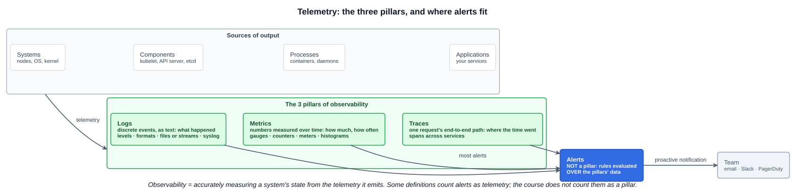
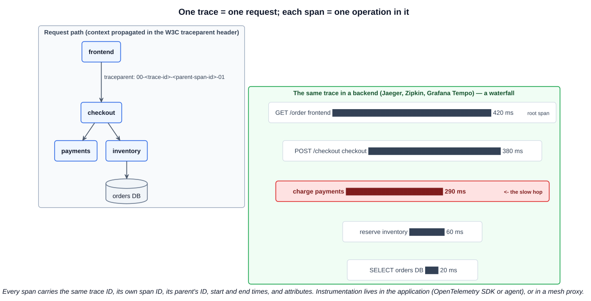
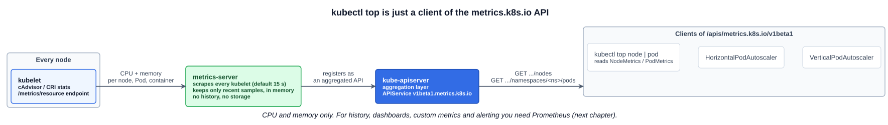

# 01 — Cloud native observability

> **Observability is the ability to accurately measure a system's state by examining the output it produces.** That output is **telemetry**: the information available to us from **systems, components, processes and applications**. Cloud native telemetry is known as **the three pillars of observability: logs, metrics and traces.**

The lecture's subtitle: **accurately monitor your system's state.** The distinction worth keeping:

- **Monitoring** watches for the failures you **predicted**: is CPU above 90%, is the endpoint returning 500s.
- **Observability** lets you answer questions you **didn't predict**: why is checkout slow only for some users in one region. You can only answer those if the telemetry is rich enough.

The study tips list what the exam wants from this chapter:

1. The 3 pillars of cloud native observability.
2. Where and why you'd use each pillar.
3. The types of metrics: **gauges, counters, meters, histograms**.
4. How **alerting** relates to the 3 pillars.
5. Awareness of **`kubectl top`**.
6. **OpenTracing / OpenTelemetry**, and that they operate at the **application layer**.

---

## 1. Telemetry and the three pillars



| Pillar | What it is | Answers | Use it when | Kubernetes example |
|---|---|---|---|---|
| **Logs** | Timestamped records of **discrete events**, usually text | **What happened?** | Debugging a specific failure, auditing, reading an error message and stack trace | `kubectl logs`, the API server **audit log** |
| **Metrics** | **Numeric measurements over time**, cheap to store and aggregate | **How much? How often? Is it normal?** | Dashboards, trends, capacity planning, autoscaling, **alerting** | CPU and memory from `kubectl top`, request rate, Pod restarts |
| **Traces** | The path of **one request** across every service it touches, as a tree of timed **spans** | **Where did the time go? Which service failed?** | Latency and errors in distributed (microservice) systems | A slow checkout traced through the frontend, checkout, payments and database |

**The pillars work together.** A metric alert tells you **something** is wrong (error rate jumped). A trace tells you **where** (the payments service). The logs tell you **why** (`connection refused` to its database). Shared IDs connect them: a trace ID written into each log line lets you jump from a trace to its logs.

### Logs

From the lecture:

- **Logs are available in a variety of formats.** Plain text, or **structured** (JSON), which machines can query by field: `{"level":"error","trace_id":"4bf9...","msg":"payment declined"}`.
- **The verbosity level can typically be adjusted.** Log levels, from most to least verbose: **TRACE, DEBUG, INFO, WARN, ERROR, FATAL**. Production usually runs at INFO. You turn on DEBUG to investigate. Kubernetes components use numeric verbosity (`-v=0` to `-v=10`; `kubectl -v=8` shows the HTTP calls, see [05-01](../05-kubernetes-deep-dive/01-kubernetes-api.md)).
- **Often file based, but other options like streaming exist.** In containers the convention is to **write to stdout/stderr** (a stream). The container runtime writes that to files under `/var/log/pods/` on the node, and `kubectl logs` reads them through the kubelet. A node-level agent such as **Fluent Bit** or **Fluentd** (run as a DaemonSet, [04-06](../04-kubernetes-fundamentals/06-daemonsets.md)) ships them to a central backend: Elasticsearch/OpenSearch, Grafana Loki, or a cloud logging service.
- **They can sometimes be manipulated through the likes of syslog.** **syslog** is the classic Unix logging standard (RFC 5424) and daemon. It routes, filters and forwards log messages by **facility** (which subsystem) and **severity** (0 Emergency to 7 Debug).

Container logs on a node are **rotated and lost when the Pod is deleted**. Central log collection is what keeps them.

### Metrics

From the lecture: **measurements emitted over a period of time**, such as memory use, how much swap is in use, or disk IOPS. They tell you whether something is **performing as expected**. Two of those examples need explaining:

- **Swap** is disk space the operating system uses as overflow for RAM. When memory is full, the kernel **pages** less-used memory out to the swap area on disk. Disk is thousands of times slower than RAM, so **rising swap usage is a warning sign of memory pressure**: the machine is short of RAM and about to get slow. Kubernetes nodes traditionally ran with swap **disabled**, because the kubelet's memory accounting and eviction assumed it. That's why the kubelet refused to start with swap on unless configured to allow it.
- **IOPS** means **input/output operations per second**: how many separate **read or write operations** a disk completes each second. It's different from **throughput** (MB/s, the volume of data) and from **latency** (how long one operation takes). A database doing many small random reads is IOPS-bound. A video encoder streaming large files is throughput-bound. Cloud volumes are sold by IOPS (for example, an AWS gp3 volume has a 3,000 IOPS baseline), and a disk at its IOPS limit makes everything on it queue.

### Traces

From the lecture: **an essential component of cloud native observability.** A trace follows the **progress of a request as it traverses the system**, giving the **end-to-end lifecycle** of that request. That provides insights a single service's logs can't, because in a microservice architecture one user click can touch a dozen services.



| Term | Meaning |
|---|---|
| **Trace** | The whole journey of **one request**, identified by a **trace ID** |
| **Span** | **One operation** inside it (an HTTP call, a DB query), with a **span ID**, its **parent span's ID**, start and end time, and attributes (tags). The first one is the **root span** |
| **Context propagation** | Passing the trace ID and current span ID **to the next service**, usually in an HTTP header. The standard is **W3C Trace Context**: the `traceparent` header (`00-<trace-id>-<parent-id>-<flags>`). Older systems use Zipkin's `X-B3-*` headers |
| **Sampling** | Recording only a fraction of traces to limit cost (for example, 1%, or always keep errors) |

A service mesh can produce spans **from its proxies** without code changes ([05-23](../05-kubernetes-deep-dive/23-service-meshes.md)). But the app still has to **forward the trace headers** from incoming to outgoing calls, or each hop starts a new trace.

---

## 2. Types of metrics

The course's four types. Prometheus's own four types are covered in [06-02](02-prometheus-and-grafana.md).

| Type | Definition | Goes | Examples | How you read it |
|---|---|---|---|---|
| **Gauge** | **Displays a level, or the contents of something**: the current value right now | **Up and down** | Memory in use, number of running Pods or components, queue depth, temperature, swap used | Read the current value directly |
| **Counter** | **A cumulative value that only increases** (resets to 0 when the process restarts) | **Up only** | Total website visits, total API requests, total errors, bytes sent | Use its **rate of increase** (requests per second), not its raw total |
| **Meter** | **The rate at which an event occurs**, such as a **heartbeat**: events per second, often as 1-, 5- and 15-minute moving averages (like `uptime`'s load averages) | A rate | Requests per second, heartbeats per minute, messages processed per second | Read the rate directly. (A *Dropwizard/Codahale Metrics* type. Prometheus has no meter: you compute `rate()` over a counter) |
| **Histogram** | **Statistical distribution** of observed values. Each observation is counted into **buckets** (also called **bins**); the **count** is how many values fall into each bucket. It also tracks the **total number of observations** and their **sum** | Buckets fill up | Request latency, response size | **Percentiles** (p50, p95, p99), averages (`sum / count`), "what % of requests took under 300 ms" |

**Why histograms matter:** an average hides outliers. If 99 requests take 10 ms and one takes 5 s, the average (≈60 ms) looks fine, while the **p99** shows that 1 in 100 users waits 5 seconds. Latency SLOs are written against percentiles, and percentiles come from histograms.

Quick test: "number of Pods currently running" is a **gauge**. "Total HTTP requests served since start" is a **counter**. "Requests per second" is a **meter** (or a rate over a counter). "Distribution of response times" is a **histogram**.

---

## 3. Alerts: related to the pillars, but not one of them

The lecture says it directly: **alerts are not one of the pillars.** Some people count alerts as part of telemetry, but an alert is **derived from** telemetry. It's a rule evaluated over logs, metrics or traces that **proactively notifies a team** of an anomaly or issue, so they can respond and resolve it quickly.

- **Most alerts are built on metrics**, because metrics are cheap to evaluate continuously: "5xx error rate above 5% for 10 minutes".
- Log-based alerts match patterns ("`OutOfMemoryError` appeared"). Trace-based alerts fire on latency or error spans.
- **Monitoring the monitoring:** a metrics system also alerts when **a collector or scrape target stops working**. In Prometheus, `up == 0` means a target can't be scraped.
- Tools: **Prometheus Alertmanager** (deduplicates, groups, silences and routes alerts) and **Grafana alerting**. Notifications go to **email, Slack, PagerDuty** and similar channels.

**Where SLIs come from.** The SRE persona's **SLI / SLO / SLA** ([02-06](../02-cloud-native-architecture/06-cloud-native-personas.md)) sits directly on this telemetry. An **SLI** is a measurement computed from metrics: uptime from a counter of successful vs failed requests, or "response time" as a percentile from a latency **histogram**. The **SLO** (under 200 ms) and **SLA** (99.99% uptime) are the targets, and the best alerts fire when an SLI threatens an SLO, before the SLA is breached. In the lecture's example, a measured 97% uptime and 300 ms response time mean both the SLA and the SLO are being missed.

---

## 4. `kubectl top` and the Metrics Server

`kubectl top` is Kubernetes' simple built-in view of **current CPU and memory use**:

```bash
kubectl top node                                 # NAME  CPU(cores)  CPU%  MEMORY(bytes)  MEMORY%
kubectl top pod                                  # current namespace
kubectl top pod -A --sort-by=memory              # all namespaces, biggest first
kubectl top pod <pod> --containers               # per container inside the Pod
kubectl top pod -l app=web                       # by label
kubectl top pod --help
```

```
NAME            CPU(cores)   CPU%   MEMORY(bytes)   MEMORY%
control-plane   440m         2%     647Mi           8%
worker-1        25m          0%     137Mi           1%
```

CPU is in millicores (`440m` is 0.44 of a core) and memory in Mi, the units from [05-17](../05-kubernetes-deep-dive/17-resource-quotas.md). `CPU%` and `MEMORY%` are relative to the node's **allocatable** capacity.

### Where the numbers come from



- The **Metrics Server** (a cluster add-on, `kubernetes-sigs/metrics-server`) scrapes CPU and memory usage from **every node's kubelet**: the kubelet's resource metrics endpoint (`/metrics/resource`), which replaced the older Summary API (`/stats/summary`). The default interval is 15 s.
- It **doesn't store metrics long term**. It keeps only the most recent samples, **in memory**.
- It **registers an aggregated API** with the API server (an `APIService` named `v1beta1.metrics.k8s.io`), so clients read metrics through ordinary API requests:
  - `GET /apis/metrics.k8s.io/v1beta1/nodes` returns **NodeMetrics**
  - `GET /apis/metrics.k8s.io/v1beta1/namespaces/<ns>/pods` returns **PodMetrics**
- **`kubectl top` is just a client of `metrics.k8s.io`**, not a special path. So are the **HorizontalPodAutoscaler** and the VPA ([02-03](../02-cloud-native-architecture/03-autoscaling.md)). No Metrics Server means `kubectl top` fails with `Metrics API not available` and the HPA shows `<unknown>` targets.

```bash
kubectl get apiservice v1beta1.metrics.k8s.io                     # AVAILABLE True?
kubectl get --raw /apis/metrics.k8s.io/v1beta1/nodes | jq .
kubectl get --raw /apis/metrics.k8s.io/v1beta1/namespaces/default/pods | jq .
```

The Metrics Server is for **autoscaling and quick checks only**. It covers just CPU and memory, with no history, no custom metrics and no alerting. That's what Prometheus is for ([06-02](02-prometheus-and-grafana.md)).

---

## 5. OpenTracing and OpenTelemetry: the application layer

The study tips stress that these **operate at the application layer**. Unlike the Metrics Server, which reads the kubelet, or a mesh, which sits in the network, tracing instrumentation lives **in your application process**.

- **OpenTracing** was a CNCF project providing a **vendor-neutral API for distributed tracing**, so code wasn't tied to one backend such as **Jaeger** or **Zipkin**. It is **archived**.
- **OpenCensus** (from Google) did the same for traces and metrics.
- In 2019 the two **merged into OpenTelemetry (OTel)**. It's now the standard: **APIs, SDKs, auto-instrumentation and a Collector** for **traces, metrics and logs**. It's CNCF **Graduated** ([02-07](../02-cloud-native-architecture/07-open-standards.md)). OpenTracing users are pointed at OpenTelemetry's migration guide.

How it works at the application layer:

1. **Instrumentation.** Developers add code, or attach an agent, that creates **spans** for operations, recording start and end times, attributes (tags) and events (logs). For Java and Spring Boot, the **OpenTelemetry Java agent** (`-javaagent:opentelemetry-javaagent.jar`) instruments HTTP clients, servers and JDBC with no code changes, and Spring Boot 3 integrates through Micrometer Tracing.
2. **Context propagation.** As requests cross service and process boundaries, the span context travels in **HTTP headers** (`traceparent`) or **message metadata**, keeping the trace continuous.
3. **Data reporting.** The SDK exports spans, at low overhead and usually batched, over **OTLP** (the OpenTelemetry Protocol), often to an **OpenTelemetry Collector** that processes them and forwards to one or more backends.
4. **Analysis and visualization.** A backend (**Jaeger**, **Zipkin**, Grafana Tempo or a commercial APM) stores the spans and draws the trace waterfall used for performance analysis and debugging.

**Vendor neutral** is the point. Instrument once with OpenTelemetry, then switch backends by changing exporter configuration, not code.

---

## Exam angle

- **Three pillars = logs, metrics, traces.** **Alerts are not a pillar.** They're rules evaluated over the pillars' data that proactively notify a team. If a question asks which is NOT one of the pillars, the answer is alerts (or events, or dashboards).
- **Match the pillar to the question:** what happened → **logs**; how much or how often, trends, alerting → **metrics**; where a request spent its time across services → **traces**.
- **Metric types:** **gauge** = current level, up and down (memory used, running Pods). **Counter** = cumulative, only increases (total requests). **Meter** = rate of events (heartbeats per second). **Histogram** = distribution in **buckets/bins**, with count and sum, giving percentiles.
- **`kubectl top node|pod`** needs the **Metrics Server**, which scrapes the kubelets, keeps recent CPU and memory **in memory only**, and serves **`metrics.k8s.io`** through the API aggregation layer. The **HPA** reads the same API.
- **OpenTracing / OpenTelemetry operate at the application layer** (instrumentation in the code). OpenTracing and OpenCensus **merged into OpenTelemetry**. Jaeger and Zipkin are tracing **backends**, not instrumentation APIs.
- **Distractor:** "`kubectl top` shows historical usage" or "the Metrics Server is a monitoring solution". It's current CPU and memory only. History and alerting need Prometheus.

## References

- [Observability primer](https://opentelemetry.io/docs/concepts/observability-primer/) — OpenTelemetry's definitions of observability, logs, metrics, traces and spans
- [Resource metrics pipeline](https://kubernetes.io/docs/tasks/debug/debug-cluster/resource-metrics-pipeline/) — Metrics Server, `metrics.k8s.io` and how `kubectl top` and the HPA use them
- [kubectl top](https://kubernetes.io/docs/reference/kubectl/generated/kubectl_top/) — command reference
- [Migrating from OpenTracing](https://opentelemetry.io/docs/migration/opentracing/) — the OpenTracing-to-OpenTelemetry path
