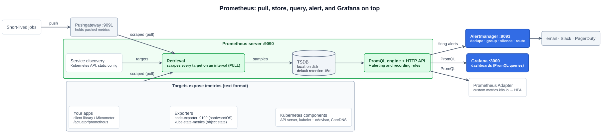
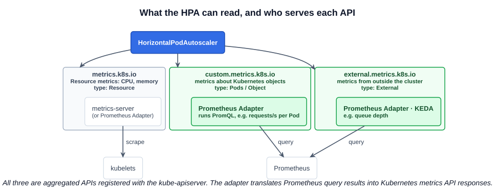

# 02 — Prometheus and Grafana

> **Prometheus is an open-source systems monitoring and alerting toolkit originally built at SoundCloud.** It collects and stores its metrics as **time series data**: metric values stored with the timestamp at which they were recorded, alongside optional key-value pairs called **labels**. — [prometheus.io](https://prometheus.io/docs/introduction/overview/)
>
> **Grafana is an open source tool for visualizing and analyzing data** from many data sources: dashboards, graphs and alerts. It stores no metrics itself.

The lecture's line for the pair: **if Prometheus is the brain, Grafana is the beauty.** Prometheus **collects, stores, queries and alerts**. Grafana **queries Prometheus** (and other sources) and **draws dashboards**.

The study tips list six things to know:

1. Prometheus and Grafana as **observability tool options**.
2. The **relationship** between them.
3. The **types of metrics** in Prometheus.
4. The purpose of **kube-state-metrics**.
5. The role of the **TSDB**.
6. How the **Prometheus Adapter** relates to the **HPA**.

---

## 1. Prometheus at a glance

- Started at **SoundCloud in 2012**. Open source from the beginning, written in **Go**.
- **Joined the CNCF in 2016 as its second hosted project, after Kubernetes**, and **graduated in August 2018**, also second after Kubernetes.
- The de facto metrics system for Kubernetes. Kubernetes components themselves expose Prometheus-format `/metrics` endpoints.

### Features from the lecture

| Feature | What it means |
|---|---|
| **Multi-dimensional data model** | Every time series is identified by a **metric name and key/value pairs (labels)**: `http_requests_total{method="POST", handler="/api/orders", code="500"}`. Each **unique combination of labels is its own time series**, so you can slice by any dimension |
| **PromQL** | Its own flexible **query language** for selecting and aggregating time series |
| **No dependency on distributed storage** | **Single server nodes are autonomous**: one Prometheus with its local disk is a complete system. That's deliberate, so monitoring keeps working when the rest of the infrastructure is failing |
| **Collection via pull (and push)** | Prometheus **pulls**: it **scrapes** each target's HTTP `/metrics` endpoint on an interval. For short-lived batch jobs that end before they can be scraped, an intermediary **Pushgateway** accepts **pushed** metrics and is scraped in turn |
| **Target discovery** | Targets come from **service discovery** (the Kubernetes API, cloud APIs) or static config. It's how new Pods get scraped automatically |
| **Alerting** | **Alerting rules** in PromQL fire alerts, and **Alertmanager** deduplicates, groups, silences and routes them to email, Slack or PagerDuty |

### Architecture



| Component | Port | Job |
|---|---|---|
| **Prometheus server** | **9090** | Discovers targets, scrapes them, stores samples in its **TSDB**, evaluates rules, serves PromQL and the web UI |
| **Alertmanager** | **9093** | Receives firing alerts from Prometheus, then deduplicates, groups, silences and routes notifications |
| **Pushgateway** | 9091 | Holds metrics **pushed** by short-lived jobs so Prometheus can scrape them |
| **Exporters** | node-exporter **9100** | Translate a system's existing stats into Prometheus format: **node-exporter** for Linux hardware and OS, plus exporters for MySQL, Redis, blackbox probing and more |
| **Client libraries** | (your app's port) | Instrument your own code. For Spring Boot: Micrometer + `micrometer-registry-prometheus` exposes `/actuator/prometheus` |
| **Grafana** | **3000** | Dashboards over PromQL |

What a scrape actually returns, the **text exposition format**:

```
# HELP http_requests_total Total HTTP requests.
# TYPE http_requests_total counter
http_requests_total{method="GET",code="200"} 1027
http_requests_total{method="GET",code="500"} 3
# TYPE process_resident_memory_bytes gauge
process_resident_memory_bytes 4.5e+07
```

---

## 2. The TSDB

Prometheus stores everything in its own **local time series database (TSDB)** on disk. That's the "no distributed storage" point above.

- A **time series** = metric name + label set. A **sample** = one **float64 value** plus a **millisecond timestamp**.
- Incoming samples go to an in-memory **head block**, protected by a **write-ahead log (WAL)** for crash recovery. They're compacted into immutable **2-hour blocks** on disk, which later merge into larger blocks.
- **Default retention: 15 days** (`--storage.tsdb.retention.time=15d`, or a size limit with `--storage.tsdb.retention.size`). Older blocks are deleted.
- It's **not** a clustered or long-term store. For durability, global views and years of history, Prometheus **`remote_write`**s to systems such as **Thanos** or **Cortex** (CNCF Incubating) or Grafana Mimir.
- **Cardinality** is the cost driver. Every distinct label value makes a new series, so a label like `user_id` or a request ID can multiply memory use until Prometheus falls over. Use labels for **bounded** dimensions (method, status code, namespace).

---

## 3. Prometheus metric types

Prometheus client libraries offer **four** types. Compare them with the course's gauge, counter, meter and histogram ([06-01](01-cloud-native-observability.md)):

| Type | Behaviour | Example | Typical PromQL |
|---|---|---|---|
| **Counter** | Cumulative, **only goes up**, resets to 0 on restart. Named `_total` by convention | `http_requests_total` | `rate(http_requests_total[5m])`: per-second rate. **This is how Prometheus does a "meter"** |
| **Gauge** | Current value, **up and down** | `node_memory_MemAvailable_bytes`, `kube_deployment_status_replicas_available` | Use directly; `avg_over_time()`, `max()` |
| **Histogram** | Observations counted into configurable **buckets** on the **server side**. Exposes `_bucket{le="..."}` (cumulative counts per upper bound), `_sum` and `_count` | `http_request_duration_seconds` | `histogram_quantile(0.95, sum by (le) (rate(http_request_duration_seconds_bucket[5m])))`: p95 latency, **aggregatable across Pods** |
| **Summary** | Like a histogram, but **quantiles are calculated in the client**. Exposes `{quantile="0.99"}`, `_sum`, `_count` | `go_gc_duration_seconds` | Read quantiles directly. They **can't be aggregated** across instances, which is why histograms are usually preferred |

There's **no meter type** in Prometheus: apply `rate()` to a counter. If an exam question lists "the four Prometheus metric types", the answer is **counter, gauge, histogram, summary**.

---

## 4. Where Kubernetes metrics come from

The stack combines several metric sources, each answering a different question:

| Source | Answers | How | Example series |
|---|---|---|---|
| **kube-state-metrics** | **What state are the Kubernetes objects in?** | **Listens to the Kubernetes API** and generates metrics about **objects**: Deployments, Pods, Nodes, Jobs, PVCs. It doesn't measure resource usage | `kube_deployment_status_replicas_available`, `kube_pod_status_phase`, `kube_pod_container_status_restarts_total`, `kube_pod_ips` |
| **node-exporter** | **How is the node's hardware and OS doing?** | A **DaemonSet** reading the **kernel's** stats (`/proc`, `/sys`) on every node | `node_cpu_seconds_total`, `node_filesystem_avail_bytes`, `node_memory_MemAvailable_bytes` |
| **kubelet / cAdvisor** | **How much CPU and memory is each container using?** | Built into the kubelet, scraped at `/metrics/cadvisor` | `container_cpu_usage_seconds_total`, `container_memory_working_set_bytes` |
| **Control plane** | **Is the cluster itself healthy?** | `/metrics` on the API server, scheduler, controller manager, etcd, CoreDNS | `apiserver_request_total`, `etcd_server_has_leader` |
| **metrics-server** | (not for Prometheus) | Current CPU and memory **for `kubectl top` and the HPA** ([06-01](01-cloud-native-observability.md)), held in memory only | via `metrics.k8s.io` |

**kube-state-metrics vs metrics-server** is the classic confusion. kube-state-metrics reports **object state** from the API ("desired 3 replicas, 2 available"). The metrics-server reports **resource usage** from the kubelets ("this Pod uses 200m CPU"). Together with node-exporter, they're what make an alert like "Deployment has had fewer replicas than desired for 15 minutes" possible.

---

## 5. The Prometheus Adapter and the HPA

The lecture calls the Prometheus Adapter a **translator between Kubernetes and Prometheus**. More precisely, it **exposes selected Prometheus metrics through the Kubernetes metrics APIs**, so Kubernetes components that only speak those APIs can use them. Its main use: **autoscaling on custom metrics.**



The HPA ([02-03](../02-cloud-native-architecture/03-autoscaling.md)) can read three aggregated APIs:

| API | Metrics | HPA metric type | Served by |
|---|---|---|---|
| `metrics.k8s.io` | **CPU and memory** (the standard resource metrics pipeline) | `Resource` | **metrics-server** (or the Prometheus Adapter's resource-metrics mode) |
| **`custom.metrics.k8s.io`** | Metrics **about Kubernetes objects**: requests per second per Pod, latency per Ingress | `Pods`, `Object` | **Prometheus Adapter** |
| **`external.metrics.k8s.io`** | Metrics from **outside the cluster**: queue length in a message broker | `External` | **Prometheus Adapter**, KEDA |

The flow, from the further-study page:

1. **Your app exposes metrics** (`/metrics`, `/actuator/prometheus`).
2. **Prometheus scrapes and stores** them.
3. **The Prometheus Adapter runs PromQL** (rules in its config, such as turning `http_requests_total` into `http_requests_per_second` with `rate()`) and **exposes the results through the Kubernetes custom/external metrics APIs**.
4. **The HPA reads those metrics and scales your Pods**, on `http_requests_per_second`, queue length, error rate or latency **instead of only CPU and memory**.

```yaml
# HPA scaling on a custom metric served by the Prometheus Adapter
apiVersion: autoscaling/v2
kind: HorizontalPodAutoscaler
metadata:
  name: web
spec:
  scaleTargetRef: {apiVersion: apps/v1, kind: Deployment, name: web}
  minReplicas: 2
  maxReplicas: 10
  metrics:
    - type: Pods
      pods:
        metric:
          name: http_requests_per_second
        target:
          type: AverageValue
          averageValue: "100"       # aim for 100 req/s per Pod
```

**The HPA never talks to Prometheus directly.** It reads only the Kubernetes metrics APIs, and the adapter (or KEDA) is the bridge.

---

## 6. Grafana

From the lecture:

| Capability | Detail |
|---|---|
| **Visualization** | Graphs, charts, tables, heatmaps, stat panels, arranged in **dashboards** |
| **Data source integration** | **Prometheus**, **InfluxDB**, **Elasticsearch**, and many more: Loki (logs), Tempo and Jaeger (traces), SQL databases, cloud monitoring. One dashboard can mix sources |
| **Observability and monitoring** | Real-time performance analysis and troubleshooting, going from a metric spike to the logs and traces of the same moment |
| **Alerting** | Alert rules evaluated by Grafana, sent through **email, Slack, PagerDuty** and others |
| **Customizability and extensibility** | Variables and templated dashboards, plugins, thousands of community dashboards to import by ID |

- Made by **Grafana Labs**, licensed AGPLv3. It's **not a CNCF project**, but it sits next to Prometheus in almost every Kubernetes monitoring stack.
- **Default port 3000.** In the kube-prometheus-stack it comes pre-wired with Prometheus as its data source and a set of Kubernetes dashboards.
- **Grafana stores no metrics.** Delete Prometheus and the dashboards go blank.

| | **Prometheus** | **Grafana** |
|---|---|---|
| Role | Collect, store, query, alert | Visualize (and alert) |
| Stores data | **Yes**: its local TSDB | **No**: it queries data sources |
| Query language | **PromQL** | Uses each source's language (PromQL for Prometheus) |
| CNCF | **Graduated** (Aug 2018) | Not CNCF (Grafana Labs) |
| Default port | 9090 | 3000 |

---

## Exam angle

- **Prometheus:** a monitoring and alerting toolkit **from SoundCloud**, the **2nd CNCF project** (2016) and **2nd to graduate** (2018). Multi-dimensional **time series** (metric name + **labels**), **PromQL**, **pull**-based scraping of `/metrics` (with a **Pushgateway** for push), autonomous single nodes with a **local TSDB** (default retention **15 days**), **Alertmanager** for notifications.
- **Grafana visualizes, Prometheus stores.** Grafana is a dashboard and alerting front end over many data sources. It isn't a database and isn't a CNCF project.
- **Prometheus metric types: counter, gauge, histogram, summary.** A counter only increases (use `rate()`). A gauge goes up and down. A histogram uses buckets (`_bucket`, `_sum`, `_count`) and can be aggregated. A summary computes quantiles client-side.
- **kube-state-metrics** = metrics about the **state of Kubernetes objects**, read from the API server. **Not** CPU and memory usage, which come from **metrics-server** or cAdvisor. **node-exporter** = node hardware and OS metrics, run as a **DaemonSet**.
- **Prometheus Adapter → HPA:** the adapter exposes Prometheus metrics through **`custom.metrics.k8s.io` / `external.metrics.k8s.io`**, so the HPA can scale on requests per second, queue length or latency. The HPA never queries Prometheus itself.
- **Distractor:** "Prometheus primarily uses a push model" (it pulls; push only via the Pushgateway), or "Prometheus requires a distributed storage backend" (single nodes are autonomous).

## References

- [Prometheus overview](https://prometheus.io/docs/introduction/overview/) — features, components, architecture, history
- [Metric types](https://prometheus.io/docs/concepts/metric_types/) — counter, gauge, histogram, summary
- [Storage](https://prometheus.io/docs/prometheus/latest/storage/) — the local TSDB, blocks, WAL, retention, remote storage
- [Prometheus Adapter](https://github.com/kubernetes-sigs/prometheus-adapter) — custom and external metrics APIs for the HPA
