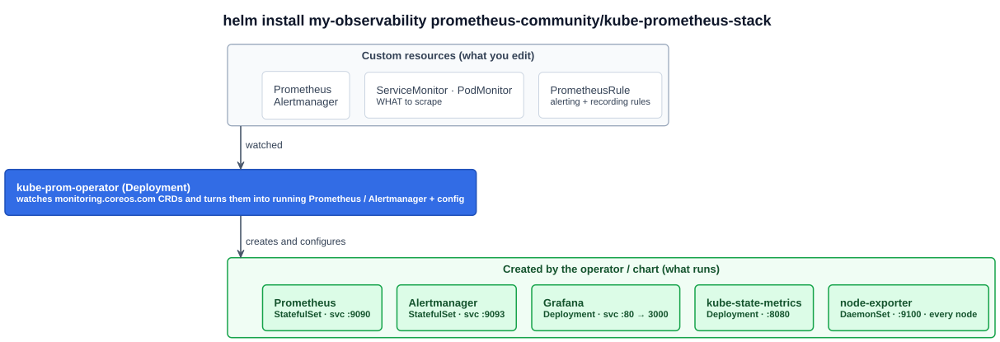

# 03 — Hands on with Prometheus (kube-prometheus-stack)

> **kube-prometheus-stack** is a Helm chart that installs a complete Kubernetes monitoring stack in one release: the **Prometheus Operator**, Prometheus, Alertmanager, Grafana, node-exporter and kube-state-metrics, preconfigured with scrape targets, dashboards and alerting rules for the cluster itself.

The lecture uses Helm ([05-21](../05-kubernetes-deep-dive/21-helm.md)) as the shortcut: one chart from the **prometheus-community** repository instead of a dozen hand-written manifests. The chart packages the **kube-prometheus** project, a nice way to set up Kubernetes with Prometheus and Grafana quickly.

---

## 1. Install

```bash
# Helm (the lecture used get-helm-3; see 05-21 for current install options)
curl https://raw.githubusercontent.com/helm/helm/main/scripts/get-helm-3 | bash

helm repo add prometheus-community https://prometheus-community.github.io/helm-charts
helm repo update
helm search repo prometheus-community/kube-prometheus-stack -l     # -l: every version
# NAME                                       CHART VERSION  APP VERSION
# prometheus-community/kube-prometheus-stack 55.5.0         v0.70.0
# ...

helm install my-observability prometheus-community/kube-prometheus-stack --version 55.5.0
# NAME: my-observability   NAMESPACE: default   STATUS: deployed   REVISION: 1
kubectl --namespace default get pods -l "release=my-observability"
```

- **The release cycle is fast.** The chart had reached 55.5.0 when the lecture was recorded, and it publishes a new major version often. The advice: **pin the lecture's version** the first time (`--version 55.5.0`) for a predictable result, then experiment with newer ones.
- **CHART VERSION vs APP VERSION** ([05-21](../05-kubernetes-deep-dive/21-helm.md)): `55.5.0` is the chart. `v0.70.0` is the **Prometheus Operator** version it ships.
- **Wait about 10 minutes** before exploring, so Prometheus has collected enough samples to show something.

---

## 2. What got installed



The lecture's "essential components":

| Component | Kind | What it does |
|---|---|---|
| **kube-prom-operator** | Deployment | The **Prometheus Operator**: a Kubernetes **Operator** that simplifies configuring a Prometheus-based monitoring stack. You describe Prometheus, Alertmanager and scrape targets as custom resources; it creates and reconfigures the workloads. Prometheus itself listens on **port 9090** |
| **Alertmanager** | **StatefulSet** | Handles alerts: deduplicates, groups and routes them |
| **Node Exporter** | **DaemonSet** | Hardware and OS metrics exposed by the **kernel**. A DaemonSet so it automatically covers every node, including ones added later ([04-06](../04-kubernetes-fundamentals/06-daemonsets.md)) |
| **kube-state-metrics** | Deployment | Gathers metrics about the **state of objects via the Kubernetes API**: the health of Deployments, Nodes, Pods |
| **Prometheus Adapter** | (not in this chart by default) | The lecture lists it as the translator between Kubernetes and Prometheus metrics. It's what lets the **HPA** use Prometheus metrics ([06-02](02-prometheus-and-grafana.md)). The `kube-prometheus` jsonnet project includes it, but the Helm chart doesn't, which is why it's missing from the `kubectl get all` output. Install it separately with `prometheus-community/prometheus-adapter` |
| **Grafana** | Deployment | The visualization layer, pre-wired to Prometheus with Kubernetes dashboards |

### The operator's custom resources

The Prometheus Operator adds CRDs in the **`monitoring.coreos.com`** API group ([05-01](../05-kubernetes-deep-dive/01-kubernetes-api.md)). This is the **Operator pattern**: a CRD adds the noun, a controller adds the verb.

| CRD | Describes |
|---|---|
| `Prometheus` / `Alertmanager` | A Prometheus or Alertmanager deployment (replicas, retention, storage) → the operator creates the **StatefulSet** |
| **`ServiceMonitor`** | **What to scrape**: selects Services by label and names the port and path. The Kubernetes-native replacement for editing `prometheus.yml` |
| `PodMonitor` | The same, selecting Pods directly |
| **`PrometheusRule`** | Alerting and recording rules |
| `AlertmanagerConfig`, `Probe`, `ScrapeConfig` | Alert routing, blackbox probes, raw scrape configs |

### The Services, from the lecture's cluster

```
NAME                                     TYPE       PORT(S)
my-observability-kube-prom-prometheus    ClusterIP  9090/TCP,8080/TCP     # Prometheus (+ config-reloader sidecar)
my-observability-kube-prom-alertmanager  ClusterIP  9093/TCP,8080/TCP     # Alertmanager
my-observability-prometheus-node-exporter ClusterIP 9100/TCP              # node-exporter
my-observability-kube-state-metrics      ClusterIP  8080/TCP              # kube-state-metrics
my-observability-kube-prom-operator      ClusterIP  443/TCP               # operator (admission webhook)
my-observability-grafana                 ClusterIP  80/TCP                # Grafana (container port 3000)
prometheus-operated                      ClusterIP  None   9090/TCP       # headless, governs the StatefulSet
alertmanager-operated                    ClusterIP  None   9093,9094/TCP,9094/UDP   # 9094 = Alertmanager cluster gossip
# kube-system: my-observability-kube-prom-kubelet (10250 ...), my-observability-kube-prom-coredns (9153): scrape targets
```

The two **headless** `*-operated` Services are the governing Services for the StatefulSets ([05-09](../05-kubernetes-deep-dive/09-statefulsets.md)). The lecture's cluster is k3s, so the Service IPs are in k3s's `10.43.0.0/16` range.

---

## 3. Access the UIs

The lecture used its lab's reverse proxy to reach the Prometheus Service's ClusterIP on port 9090. Anywhere else, **port-forward**:

```bash
kubectl port-forward svc/my-observability-kube-prom-prometheus 9090:9090    # http://localhost:9090
kubectl port-forward svc/my-observability-grafana 3000:80                   # http://localhost:3000
kubectl port-forward svc/my-observability-kube-prom-alertmanager 9093:9093  # http://localhost:9093

# Grafana's admin password (user: admin), generated into a Secret by the chart
kubectl get secret my-observability-grafana -o jsonpath='{.data.admin-password}' | base64 -d; echo
```

---

## 4. The Prometheus UI

- **Query (Graph) page**: type a PromQL expression and **Execute**. Autocomplete suggests metric names as you type.
- **Metrics Explorer** (the globe icon next to Execute) lists every metric name Prometheus has. There are a lot out of the box.
- **Table** tab: the current value of every matching series, with all its labels. **Graph** tab: values over a time range (`1h`, `5m`, ...). The **stacked** toggle makes overlapping lines visible.
- **Status → Targets** shows every scrape target and whether it's `UP`. **Alerts** shows the preloaded rules and which are firing.

The lecture's queries:

```promql
kube_pod_ips
# one series per Pod: labels container, endpoint, instance, ip, ip_family, job="kube-state-metrics",
# namespace, pod, service, uid. Value 1. Gathered by kube-state-metrics.

apiserver_request_total
# a counter from the API server itself, labelled by verb, resource, code, scope, version...
```

On the **Graph** tab, `kube_pod_ips` first shows **one line**. Every series has the value `1`, so all the Pod lines are drawn on top of each other. Switch to **stacked** mode and each Pod becomes its own band, so the total height is the Pod count.

**Watch it change.** Create Pods one at a time, set the range to **5m**, and keep executing:

```bash
for i in {1..10}; do kubectl run nginx${i} --image=nginx; sleep 30; done    # 10 Pods over 5 minutes
```

```promql
count(kube_pod_ips)                         # how many Pods have an IP
count by (namespace) (kube_pod_info)        # Pods per namespace
sum by (verb) (rate(apiserver_request_total[5m]))                  # API requests/s by verb
sum by (code) (rate(apiserver_request_total[5m]))                  # ...by HTTP status
topk(5, sum by (pod) (rate(container_cpu_usage_seconds_total[5m]))) # busiest Pods (cAdvisor)
kube_deployment_status_replicas_available < kube_deployment_spec_replicas   # under-replicated
up == 0                                     # targets Prometheus can't scrape
```

### PromQL in five ideas

| Idea | Example |
|---|---|
| **Selector with label matchers** (`=`, `!=`, `=~`, `!~`) | `http_requests_total{namespace="shop", code=~"5.."}` |
| **Range vector** (`[5m]`): the samples over a window | `http_requests_total[5m]` |
| **`rate()` turns a counter into per-second** | `rate(http_requests_total[5m])` |
| **Aggregation `by`/`without`** | `sum by (service) (rate(http_requests_total[5m]))` |
| **Comparison filters, which is how alerts work** | `... > 0.05` returns only the series over the threshold |

---

## 5. On k3s or a homelab: things the lecture skipped

- **Use a namespace.** `helm install ... -n monitoring --create-namespace`. The lecture used `default`.
- **ServiceMonitors need the release label.** By default the chart's Prometheus only selects ServiceMonitors labelled **`release: <release-name>`** (`serviceMonitorSelectorNilUsesHelmValues: true`). A ServiceMonitor without that label is silently ignored. Set the value to `false` to make Prometheus select all of them.
- **k3s control-plane targets show DOWN.** k3s runs the scheduler, controller manager and etcd inside one process and doesn't expose their metrics endpoints the way kubeadm does, so `kubeControllerManager`, `kubeScheduler`, `kubeEtcd` and `kubeProxy` alerts fire. Disable those scrapes in values, or expose the endpoints in k3s's config.
- **Persist the data.** Without `storageSpec`, Prometheus stores its TSDB in an `emptyDir`, and a Pod restart loses all history ([05-08](../05-kubernetes-deep-dive/08-kubernetes-storage.md)). The chart also sets its own retention, `10d`, overriding the binary's 15-day default.
- **Uninstalling leaves the CRDs.** `helm uninstall` doesn't remove `monitoring.coreos.com` CRDs. Delete them yourself if you want a clean slate.

A ready-made values file, a ServiceMonitor for a Spring Boot app and an alert rule are in [`examples/observability/`](../../examples/observability/).

---

## Exam angle

- **kube-prometheus-stack** = the Helm chart (from **prometheus-community**) that installs the Prometheus **Operator**, Prometheus, Alertmanager, Grafana, **node-exporter** and **kube-state-metrics** in one release.
- **Workload kinds:** Prometheus and **Alertmanager run as StatefulSets** (created by the operator). **node-exporter runs as a DaemonSet** (every node). The operator, kube-state-metrics and Grafana are Deployments.
- **The Prometheus Operator** manages Prometheus through CRDs: **`ServiceMonitor`/`PodMonitor`** say what to scrape, **`PrometheusRule`** holds alerts. It's an example of the Operator pattern.
- **Ports:** Prometheus **9090**, Alertmanager **9093**, node-exporter **9100**, Grafana **3000** (the chart's Service exposes 80).
- **Distractor:** "kube-state-metrics reports Pod CPU usage". It reports **object state** (`kube_pod_ips`, replica counts). Usage comes from cAdvisor and metrics-server.

## References

- [kube-prometheus-stack chart](https://github.com/prometheus-community/helm-charts/tree/main/charts/kube-prometheus-stack) — install, values, upgrade notes between majors
- [Prometheus Operator](https://prometheus-operator.dev/) — the CRDs: Prometheus, Alertmanager, ServiceMonitor, PodMonitor, PrometheusRule
- [Querying basics](https://prometheus.io/docs/prometheus/latest/querying/basics/) — PromQL selectors, range vectors, functions and aggregation
- [kube-state-metrics](https://github.com/kubernetes/kube-state-metrics) — the exposed metrics, per object kind
