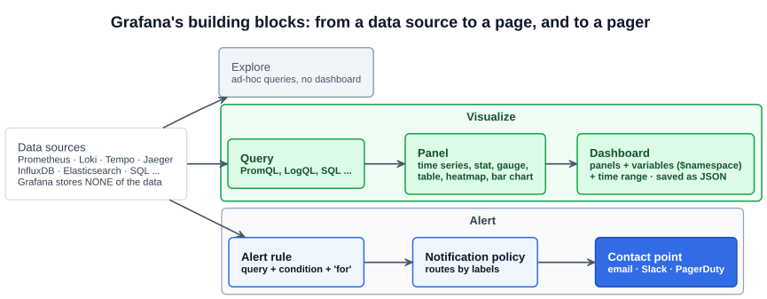

# 04 — Hands on with Grafana

> **Grafana is an open source tool for querying, visualizing, alerting on and exploring metrics, logs and traces, wherever they are stored.** It connects to **data sources** and draws **dashboards** from their data. It doesn't store the data itself.

This chapter covers the course's Part 3 lecture (hands on with Grafana). No screenshots of that lecture were captured, so it's built from the Grafana documentation and the kube-prometheus-stack defaults, continuing from the cluster in [06-03](03-hands-on-with-prometheus.md). The concepts (Grafana as the visualization layer, its relationship to Prometheus) are in [06-02](02-prometheus-and-grafana.md).

---

## 1. Grafana's building blocks



| Concept | What it is |
|---|---|
| **Data source** | A connection to a backend Grafana queries: **Prometheus** (metrics), **Loki** (logs), **Tempo** or **Jaeger** (traces), InfluxDB, Elasticsearch, MySQL/PostgreSQL, cloud monitoring services. Each has its own query language |
| **Query** | What a panel asks a data source for: **PromQL** for Prometheus, LogQL for Loki |
| **Panel** | One visualization of one or more queries: **time series**, **stat** (a single big number), **gauge**, **bar gauge**, **table**, **heatmap** (good for histogram buckets), logs, traces |
| **Dashboard** | A page of panels sharing a **time range** and **variables**. Stored as **JSON**, so dashboards can be exported, version-controlled and imported |
| **Variable** | A dropdown at the top of a dashboard (`$namespace`, `$pod`) whose value is substituted into every query. One dashboard serves every namespace |
| **Explore** | Ad-hoc querying without building a dashboard. It's the place to investigate, and to jump from a metric spike to the matching logs and traces |
| **Alerting** | **Alert rules** (a query, a condition and a `for` duration) → **notification policies** (route by labels) → **contact points** (email, Slack, PagerDuty, webhooks) |

**Grafana vs Prometheus once more:** Prometheus collects, stores, queries and alerts on **metrics**. Grafana is a **front end** over Prometheus and many other sources. The lecture's line: *if Prometheus is the brain, Grafana is the beauty.*

---

## 2. Log in

kube-prometheus-stack installs Grafana as a Deployment, **already wired to the stack's Prometheus as its default data source**, with a set of Kubernetes dashboards preloaded.

```bash
# Release "my-observability" from 06-03, in the default namespace
kubectl port-forward svc/my-observability-grafana 3000:80        # Service port 80 → container port 3000
kubectl get secret my-observability-grafana -o jsonpath='{.data.admin-user}' | base64 -d; echo
kubectl get secret my-observability-grafana -o jsonpath='{.data.admin-password}' | base64 -d; echo
```

Open `http://localhost:3000` and sign in as `admin`. Older versions of the chart used the fixed password `prom-operator`. Current ones generate one into the Secret unless you set `grafana.adminPassword`.

Check **Connections → Data sources**: a **Prometheus** data source pointing at the in-cluster Prometheus Service (`http://my-observability-kube-prom-prometheus.default:9090`). **Save & test** confirms Grafana can reach it.

---

## 3. The preloaded dashboards

**Dashboards → Browse** shows the chart's defaults (`defaultDashboardsEnabled: true`). The most useful ones:

| Dashboard | Shows | Built from |
|---|---|---|
| **Kubernetes / Compute Resources / Cluster** | CPU and memory usage vs requests vs limits, per namespace | cAdvisor + kube-state-metrics |
| **Kubernetes / Compute Resources / Namespace (Pods)** | The same per Pod, with a `namespace` variable | cAdvisor + kube-state-metrics |
| **Kubernetes / Compute Resources / Node (Pods)** | Which Pods use a node's capacity | cAdvisor |
| **Node Exporter / Nodes** | Node CPU, load, memory, disk I/O and space, network | **node-exporter** |
| **Kubernetes / API server**, **CoreDNS**, **Kubelet** | Control-plane health | component `/metrics` |
| **Alertmanager / Overview** | Alerts received and notifications sent | Alertmanager |

Things to try:

- Change the **time range** (top right) and the **refresh** interval. Pick a `namespace` in a dashboard's **variable** dropdown.
- **Edit** any panel to see the **PromQL** behind it. It's the best way to learn PromQL, because every panel is a worked example.
- Rerun the Pod loop from [06-03](03-hands-on-with-prometheus.md) and watch the namespace's Pod count and CPU move.

---

## 4. Build your own panel

1. **Dashboards → New → New dashboard → Add visualization**, and pick the **Prometheus** data source.
2. Enter a query in **Code** mode, or build one with the point-and-click **Builder**:

```promql
sum by (namespace) (kube_pod_info)                                         # Pods per namespace  (stat or bar gauge)
sum by (namespace) (rate(container_cpu_usage_seconds_total{container!=""}[5m]))   # CPU cores used per namespace (time series)
sum by (verb) (rate(apiserver_request_total[5m]))                           # API requests/s by verb
histogram_quantile(0.95, sum by (le) (rate(apiserver_request_duration_seconds_bucket{verb!="WATCH"}[5m])))   # p95 API latency
```

3. Choose the visualization type, set the **unit** (cores, bytes, req/s, seconds), add a title, then **Save dashboard**.
4. **Add a variable:** Dashboard settings → **Variables** → New, type **Query**, query `label_values(kube_pod_info, namespace)`. Then use `{namespace="$namespace"}` in the panel queries.

### Import a community dashboard

**Dashboards → New → Import**, enter an ID from [grafana.com/grafana/dashboards](https://grafana.com/grafana/dashboards/), choose the Prometheus data source. **1860 (Node Exporter Full)** is the classic one for node-exporter.

---

## 5. Alerting in Grafana

1. **Alerting → Contact points** → add one (email, Slack webhook, PagerDuty key).
2. **Alerting → Alert rules → New alert rule**: query `sum(kube_pod_status_phase{phase="Failed"}) > 0`, evaluate every 1m, **pending period** 5m (the `for`: how long the condition must hold before firing).
3. **Notification policies** route alerts to contact points by **labels** (`severity=critical` → PagerDuty, everything else → Slack).

In this stack, alerts can come from **two places**: **Prometheus alerting rules** (`PrometheusRule` objects, routed by **Alertmanager**, see [06-03](03-hands-on-with-prometheus.md)) and **Grafana-managed rules**. Pick one place per alert, or you'll get paged twice.

---

## 6. Dashboards as code

Dashboards built by clicking live only in Grafana's database (and vanish if Grafana has no persistence). The GitOps way (section 7) is to **store dashboard JSON in Git** and let the cluster load it. kube-prometheus-stack's Grafana runs a **sidecar** that loads any ConfigMap labelled **`grafana_dashboard: "1"`**, in any namespace:

```yaml
apiVersion: v1
kind: ConfigMap
metadata:
  name: orders-dashboard
  namespace: shop
  labels:
    grafana_dashboard: "1"        # the sidecar watches for this label
data:
  orders.json: |
    { "title": "Orders", "panels": [ ... ] }    # export from Dashboard settings → JSON Model
```

Data sources can be provisioned the same way, with ConfigMaps labelled `grafana_datasource: "1"`.

---

## Exam angle

- **Grafana visualizes; it doesn't store.** It queries **data sources** (Prometheus, Loki, Elasticsearch, InfluxDB ...) and draws **dashboards** made of **panels**. If a question asks where the time series are stored, the answer is Prometheus's TSDB, not Grafana.
- **The relationship:** Prometheus scrapes and stores metrics and evaluates rules. Grafana uses **Prometheus as a data source** and sends **PromQL** to it.
- **Grafana alerting:** alert rules → notification policies → contact points (email, Slack, PagerDuty). Prometheus has its own path: alerting rules → **Alertmanager**.
- **Grafana's default port is 3000.** It's a **Grafana Labs** project, not CNCF.

## References

- [Introduction to Grafana](https://grafana.com/docs/grafana/latest/introduction/) — what Grafana is and does
- [Dashboards](https://grafana.com/docs/grafana/latest/dashboards/) — panels, variables, import and JSON model
- [Grafana Alerting fundamentals](https://grafana.com/docs/grafana/latest/alerting/fundamentals/) — alert rules, notification policies, contact points
- [Explore](https://grafana.com/docs/grafana/latest/explore/) — ad-hoc queries across metrics, logs and traces
