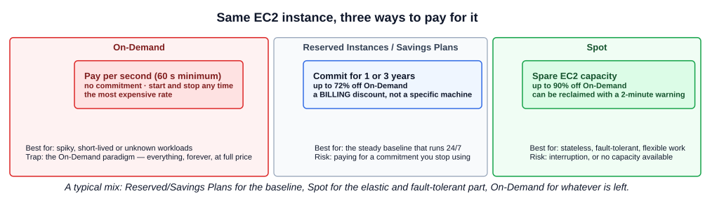
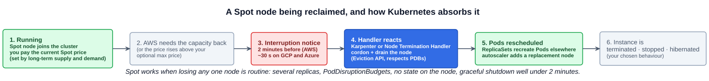
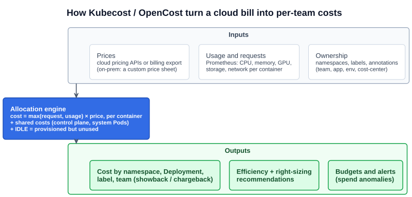

# 05 — Cost management (cloud native FinOps)

> **FinOps is an operational framework and cultural practice which maximizes the business value of cloud and technology, enables timely data-driven decision making, and creates financial accountability through collaboration between engineering, finance, and business teams.** — [FinOps Foundation](https://www.finops.org/introduction/what-is-finops/) (a Linux Foundation project)

The lecture's subtitle is **cloud native FinOps**, and its three opening points:

- **Make effective use of cloud resources and cloud native approaches to minimize costs.** Containers pack workloads densely, autoscaling removes idle capacity, and scale-to-zero removes it entirely.
- **Use per-second billing.** On AWS, EC2 On-Demand, Reserved and Spot Linux instances are **billed in one-second increments, with a minimum of 60 seconds** (since October 2017). A node that exists for 10 minutes costs 10 minutes, so adding and removing capacity aggressively is cheap. Serverless goes further, with per-millisecond billing ([02-04](../02-cloud-native-architecture/04-serverless.md)).
- **Dynamic compute across the estate.** Short-lived, right-sized, automatically provisioned capacity replaces a fixed fleet sized for peak load.

Cost is also an **observability** problem, which is why it closes section 6. You can't reduce what you can't see, and cost tools are built on the same metrics pipeline as Prometheus ([06-02](02-prometheus-and-grafana.md)). The **FinOps engineer** persona owns this ([02-06](../02-cloud-native-architecture/06-cloud-native-personas.md)).

The study tips name two exam points: **cloud anomaly detection** and **Kubecost as a tool for cost observability**.

---

## 1. Picking the right resources

- **Where it runs.** Cloud native applications can run across **different cloud providers**, as well as **hybrid and private clouds**. Hybrid or private can be the requirement, for **regulatory** reasons (data residency, sovereignty) or for **cost**: steady, predictable load is often cheaper on owned hardware than rented by the second.
- **What it runs on.** Public clouds offer large catalogues of instance types. EC2 alone has hundreds, organized into families tuned for a resource:

| Family (EC2 examples) | Tuned for | Typical workload |
|---|---|---|
| **General purpose** (M, T) | Balanced CPU and memory | Web services, most microservices |
| **Compute optimized** (C) | More CPU per GB | Batch, encoding, CPU-bound APIs |
| **Memory optimized** (R, X) | More memory per vCPU | Databases, caches, JVMs with big heaps |
| **Storage optimized** (I, D) | Fast local disks, high **IOPS** ([06-01](01-cloud-native-observability.md)) | Search, analytics, NoSQL |
| **Accelerated** (P, G, Inf, Trn) | **GPUs** or ML chips | Training, inference, rendering |

Choosing the family that matches the workload's actual bottleneck is the first cost decision. A memory-bound service on compute-optimized nodes pays for idle cores.

---

## 2. Three ways to pay: On-Demand, Reserved, Spot



### On-Demand

**Create and deploy compute instances as required, and pay only while they run.** Provisioning and de-provisioning is fast, sometimes seconds. There's no commitment.

The lecture's warning: it can be **the most expensive option**, and without thought you fall into the **On-Demand paradigm**, running everything, permanently, at the full rate because it was the easiest thing to click.

### Reserved Instances and Savings Plans

The lecture's restaurant "RESERVED" sign: **commit in advance, get a lower price.**

- **Reserved Instances (RIs):** commit to an instance type in a region for **1 or 3 years** in exchange for **up to 72% off** On-Demand pricing. Paying upfront (all, partial, or none) increases the discount.
- **Savings Plans:** the newer, more flexible form. You commit to a **dollar amount per hour** of compute for 1 or 3 years instead of a specific instance type. Compute Savings Plans also cover Fargate and Lambda.
- **An RI is a billing discount, not a machine.** It's applied automatically to any running instance that matches. The lecture's question, *how do we reuse the previous instances?*, has the answer: keep matching usage running so the commitment is used. Converting to newer instance types (**Convertible RIs** or Savings Plans), or selling unused **Standard RIs** on the RI Marketplace, avoids paying for a commitment nothing uses.
- **Use them for the baseline**: the capacity that runs 24/7 whatever the load (control plane, the minimum replica count, databases).

### Spot instances, explained properly

The slide says *"bid on an instance for a period of time"* with *"no guarantee that the resources will be available, or you may be outbid"*. That describes how Spot **used to** work. Here's how it works now.

**What Spot is.** A cloud provider always has unused capacity: servers that are racked and powered but not rented right now. **Spot instances rent that spare capacity at a steep discount, up to 90% off On-Demand on AWS.** The catch: **the provider can take it back** when it needs the capacity for On-Demand or Reserved customers.

**How the price works today.** AWS **removed bidding in late 2017**. Now:

- You **pay the current Spot price** for that instance type in that Availability Zone. AWS adjusts it **gradually, based on long-term supply and demand**, not through a live auction.
- You **may** set a **maximum price**. If you don't, it defaults to the On-Demand price. AWS recommends not setting one. A low maximum price only adds a second interruption reason ("the price rose above my max") without saving anything.
- So "being **outbid**" is mostly historical. The normal reason for interruption is **AWS needing the capacity back**.

**What an interruption looks like.**

1. AWS issues an **interruption notice two minutes before** it stops or terminates the instance, through instance metadata and an EventBridge event. A **rebalance recommendation** may arrive even earlier, when the risk of interruption rises.
2. You choose the **interruption behavior** in advance: **terminate** (default), **stop**, or **hibernate** (save RAM to disk and resume later).
3. Other clouds have the same idea with a shorter warning: **GCP Spot VMs** and **Azure Spot VMs** give about **30 seconds**.

**"No guarantee the resources will be available"** is still true, in two ways: the instance can be **reclaimed** at any time, and when you ask for Spot capacity there may be **none** for that type in that zone. The defence is **flexibility**: request many instance types across several Availability Zones, and let an allocation strategy (`price-capacity-optimized`) pick the pools least likely to be interrupted.

**What belongs on Spot.** Work that can **lose a node without anyone noticing**:

| Good fit | Poor fit |
|---|---|
| Stateless web and API replicas (several of them, behind a Service) | A single-replica service |
| Batch jobs, CI runners, data processing that checkpoints | Databases, stateful sets with node-local data |
| Dev and test clusters | Long jobs that can't resume |
| Big rendering or ML training with checkpoints | Anything that can't shut down cleanly in under 2 minutes |

### Spot in Kubernetes

Kubernetes is a natural fit for Spot, because rescheduling Pods off a dying node is what it already does ([05-18](../05-kubernetes-deep-dive/18-when-nodes-fail.md)).



- **Separate node pools.** Run a Spot node group alongside an On-Demand one. Label and **taint** the Spot nodes ([05-06](../05-kubernetes-deep-dive/06-taints-and-tolerations.md)) so only workloads that **tolerate** interruption land there. EKS labels them `eks.amazonaws.com/capacityType: SPOT`, and Karpenter uses `karpenter.sh/capacity-type: spot`.
- **React to the notice.** **Karpenter** (natively) or the **AWS Node Termination Handler** watches for the 2-minute notice, then **cordons and drains** the node through the Eviction API, honouring **PodDisruptionBudgets** ([05-13](../05-kubernetes-deep-dive/13-pod-disruption-budgets.md)). Pods move before the machine disappears.
- **Replace capacity.** The **Cluster Autoscaler** or **Karpenter** ([02-03](../02-cloud-native-architecture/03-autoscaling.md)) provisions a new node, Spot if available, otherwise On-Demand.
- **Design for it.** Multiple replicas spread across nodes and zones ([05-07](../05-kubernetes-deep-dive/07-affinity-and-anti-affinity.md)), readiness probes, and a `terminationGracePeriodSeconds` well under 120 s.

| | **On-Demand** | **Reserved / Savings Plans** | **Spot** |
|---|---|---|---|
| Commitment | None | 1 or 3 years | None |
| Discount vs On-Demand | — | **Up to 72%** | **Up to 90%** |
| Can be taken away | No | No | **Yes: 2-minute notice (AWS)** |
| Price | Fixed list price | Fixed, discounted | Varies gradually with supply and demand |
| Best for | Spiky, unpredictable, short-lived | Steady 24/7 baseline | Stateless, fault-tolerant, flexible |

---

## 3. Right sizing

**Right sizing** means matching the resources you pay for to what the workload actually uses.

- **The anti-pattern: lift and shift.** Moving an application to the cloud on the **same resources it had on-premises**. A VM sized years ago for peak load, now billed every second, mostly idle.
- **Use autoscaling instead.** **HPA** for replicas, **VPA** for requests, **Cluster Autoscaler or Karpenter** for nodes, **KEDA** or Knative for scale to zero ([02-03](../02-cloud-native-architecture/03-autoscaling.md)).
- **In Kubernetes, requests are the bill.** The scheduler reserves a Pod's **requests** on a node whether the Pod uses them or not ([05-17](../05-kubernetes-deep-dive/17-resource-quotas.md)). Requests set at 2 CPU for a service that uses 200m mean nodes full of reserved, idle CPU, and you pay for the nodes. Right sizing in Kubernetes is **setting requests close to observed usage**, which is what VPA recommendations and Kubecost's right-sizing reports measure.

---

## 4. Cloud anomaly detection

**An automated means of detecting harmful outliers in spend**, so you catch an unexpected cost **in hours instead of on next month's invoice**.

- It learns the normal spending pattern per service or account, then alerts when spend deviates: a forgotten GPU node, a runaway autoscaler, a misconfigured job looping, a sudden spike in **data transfer**.
- Examples: **AWS Cost Anomaly Detection**, and the equivalents in Azure Cost Management and Google Cloud billing. It's the alerting idea from [06-01](01-cloud-native-observability.md), applied to money.
- **A correction to the slide's "ingress/egress traffic":** cloud providers generally **don't charge for ingress** (data coming in). **Egress** is what's billed: data leaving to the internet, and traffic **between Availability Zones or regions**. A chatty service calling across zones, or a misconfigured backup copying to another region, is a classic surprise bill.

---

## 5. Kubecost and OpenCost: cost observability for Kubernetes

A cloud bill says "these 12 EC2 instances cost $3,000". It can't say **which team, namespace or Deployment** spent it, because many Pods share each node. Kubernetes cost tools answer that.



- **Kubecost** provides **real-time cost visibility and insights for teams using Kubernetes**: cost by namespace, Deployment, label or team, **idle cost**, efficiency, right-sizing recommendations, budgets and alerts. It's a **commercial product** with a free tier, installed with Helm, and reads usage from **Prometheus**. Kubecost was acquired by **IBM** in 2024 (now "IBM Kubecost", part of Apptio).
- **OpenCost** is the **open source, vendor-neutral** core: a specification and implementation for Kubernetes cost allocation, contributed by Kubecost. It's a **CNCF Incubating** project. If a question asks for "the CNCF project for Kubernetes cost monitoring", the answer is OpenCost.
- **How allocation works:** each container is charged for **the larger of its requests and its usage**, multiplied by the node's price per CPU-hour and GB-hour (from the cloud's pricing API or billing export, or a custom price sheet on-prem). Shared costs (control plane, system Pods) are spread on top. The remainder, **provisioned but not allocated**, is reported as **idle**.
- **Labels make it work.** Allocation by team only works if workloads carry ownership labels (`team`, `app.kubernetes.io/part-of`, `cost-center`; see [04-12](../04-kubernetes-fundamentals/12-labels-and-selectors.md)).
- **Showback vs chargeback:** **showback** reports each team's costs to them. **Chargeback** actually bills those costs to the team's budget.

```bash
# OpenCost (open source) with Helm; it needs a Prometheus to read from
helm repo add opencost https://opencost.github.io/opencost-helm-chart
helm install opencost opencost/opencost -n opencost --create-namespace \
  --set opencost.prometheus.internal.namespaceName=monitoring \
  --set opencost.prometheus.internal.serviceName=mon-kube-prom-prometheus \
  --set opencost.prometheus.internal.port=9090    # point it at the 06-03 kube-prometheus-stack (defaults: prometheus-server.prometheus-system:80)
kubectl -n opencost port-forward svc/opencost 9090:9090      # UI at http://localhost:9090
```

---

## Exam angle

- **FinOps** = cloud financial management: engineering, finance and business **collaborating** on cloud spend. It's a **cultural practice** as much as tooling. The FinOps engineer persona owns it.
- **Purchase options:** **On-Demand** (flexible, priciest), **Reserved Instances / Savings Plans** (1–3 year commitment, up to 72% off; for the baseline), **Spot** (spare capacity, up to 90% off, **can be interrupted** with a 2-minute notice on AWS; for fault-tolerant work).
- **Spot today isn't an auction.** You pay a Spot price that moves gradually with supply and demand. Interruption is mainly about the provider reclaiming capacity. If an answer option says "Spot instances are guaranteed", it's wrong.
- **Right sizing** fixes **lift and shift**: match requests and instance types to actual usage, and **autoscale**.
- **Cloud anomaly detection** = **automated detection of harmful outliers** in spend (CPU, GPU, network transfer), to avoid unexpected costs.
- **Kubecost** = Kubernetes **cost observability** (cost per namespace, workload or label). Its open source core, **OpenCost**, is the **CNCF** project.

## References

- [What is FinOps?](https://www.finops.org/introduction/what-is-finops/) — the FinOps Foundation definition and principles
- [How Spot Instances work](https://docs.aws.amazon.com/AWSEC2/latest/UserGuide/using-spot-instances.html) — Spot pricing, interruption notices and behaviours
- [AWS Cost Anomaly Detection](https://aws.amazon.com/aws-cost-management/aws-cost-anomaly-detection/) — anomaly detection on cloud spend
- [OpenCost](https://www.opencost.io/) — the CNCF project for Kubernetes cost allocation
