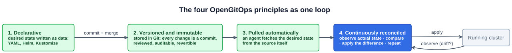
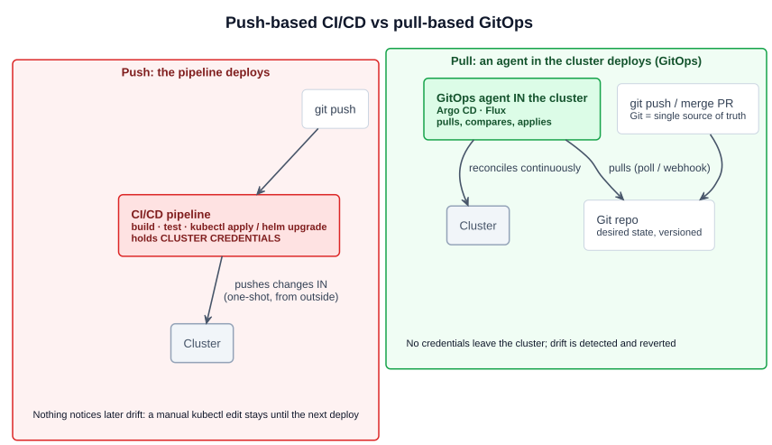
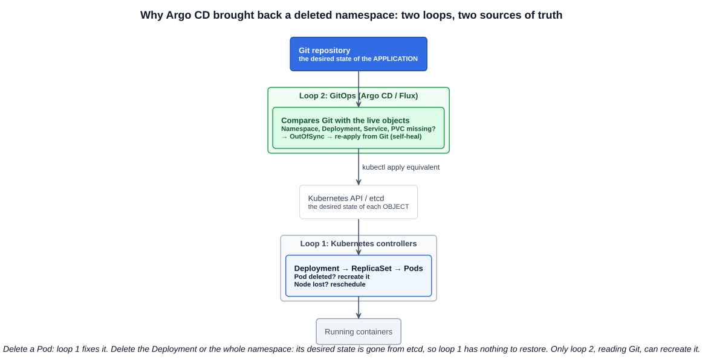

# 01 — Cloud native application delivery and GitOps

> **GitOps is a set of principles for operating and managing software systems**, in which the **desired state** of the system is **declared**, **versioned in Git** (or another versioned source), **pulled automatically** by software agents, and **continuously reconciled** against the running system. — after [OpenGitOps](https://opengitops.dev/)

**Cloud native application delivery** is how a change gets from a developer's commit to running in production, **fast, repeatedly and safely**. The lecture's three goals and the three enablers behind them:

| Goal | Enabled by |
|---|---|
| **Fast paced**: ship many small changes a day | **Containerization**: one immutable image runs the same everywhere ([section 3](../03-containers-with-docker/)) |
| **Scalable**: grow teams and services independently | **Microservices**: each service deployed on its own ([02-01](../02-cloud-native-architecture/01-monolithic-vs-microservices.md)) |
| **Resilient**: failures are absorbed, not escalated | **Dynamic orchestration**: Kubernetes schedules, heals and scales ([section 4](../04-kubernetes-fundamentals/)) |

**CI/CD** is the delivery pipeline ([02-02](../02-cloud-native-architecture/02-cloud-native-practices.md)): **continuous integration** builds and tests every commit, and **continuous delivery/deployment** releases it. **GitOps** is a specific, Kubernetes-friendly way to do the **CD** half.

The section's study tips: **Argo** and how it fits the GitOps lifecycle ([07-02](02-argo-cd.md)), **Argo Workflows** ([07-03](03-argo-workflows-and-the-argo-family.md)), and **Flux** with the **GitOps Toolkit** ([07-04](04-flux-and-the-gitops-toolkit.md)).

---

## 1. GitOps, from the lecture

- **"The future of infrastructure management."** It's **great for Kubernetes cluster management**, because Kubernetes is already declarative: every object is a YAML document, so a whole cluster's apps can be described as files.
- **Application delivery with Git as the single source of truth.** What's in Git is what should be running. If the cluster and Git disagree, **Git wins**.
- **GitOps is about using Git to manage your infrastructure and applications.** That covers the apps, and also the platform: Ingress controllers, monitoring stacks, RBAC, namespaces, quotas.

The term was coined by **Weaveworks** (the company behind Flux) in **2017**. The vendor-neutral definition is now maintained by **OpenGitOps**, a **CNCF Sandbox** project overseen by the CNCF's GitOps Working Group.

### The four OpenGitOps principles

| # | Principle | Official wording | In practice |
|---|---|---|---|
| 1 | **Declarative** | *A system managed by GitOps must have its desired state expressed declaratively.* | Kubernetes YAML, Helm charts, Kustomize overlays ([05-21](../05-kubernetes-deep-dive/21-helm.md), [05-22](../05-kubernetes-deep-dive/22-kustomize.md)): what, not how |
| 2 | **Versioned and immutable** | *Desired state is stored in a way that enforces immutability, versioning and retains a complete version history.* | Git: every change is a commit with an author, reviewed in a pull request; rollback is `git revert` |
| 3 | **Pulled automatically** | *Software agents automatically pull the desired state declarations from the source.* | **Argo CD** or **Flux** in the cluster fetch from Git; nobody pushes into the cluster |
| 4 | **Continuously reconciled** | *Software agents continuously observe actual system state and attempt to apply the desired state.* | The agent compares Git with the live cluster on a loop and corrects any difference (**drift**) |

**Principle 4 is the Kubernetes controller pattern** (observe, compare, act) applied one level higher. Kubernetes reconciles the cluster toward the objects in etcd. GitOps reconciles the objects in etcd toward the files in Git.

---

## 2. Push vs pull deployment

| | **Push-based CI/CD** | **Pull-based GitOps** |
|---|---|---|
| Who changes the cluster | The pipeline, from **outside** (`kubectl apply`, `helm upgrade` in a CI job) | An **agent inside the cluster** (Argo CD, Flux) |
| Cluster credentials | Stored **in the CI system**, a high-value secret outside the cluster | **Stay in the cluster**. The agent only needs **read** access to Git |
| When it acts | Once, when the pipeline runs | **Continuously** |
| Drift (someone runs `kubectl edit`) | **Goes unnoticed** until the next deploy overwrites it, or not | **Detected** (OutOfSync) and optionally **reverted** automatically |
| Audit and rollback | Pipeline logs; rollback means re-running an old pipeline | **Git history** is the audit log; rollback = **revert the commit** |
| Firewalls | CI must reach the API server | The cluster only makes **outbound** calls to Git |

**CI stays.** GitOps replaces how things get **deployed**, not how they're **built**. The usual split:

1. **CI** (GitHub Actions, GitLab CI, Jenkins, Tekton) builds and tests the code, then **pushes an image** to a registry.
2. CI, or an image-automation tool, **commits the new image tag** to a **config repository** (often separate from the app's source repo).
3. The **GitOps agent** notices the commit and **syncs** the cluster.

---

## 3. Self-healing, one level up

The lecture's demo: with Argo CD managing an application, **deleting the entire namespace** brought everything back almost immediately.

- **Kubernetes self-healing** ([04-05](../04-kubernetes-fundamentals/05-deployments-and-replicasets.md)) works from the desired state **stored in etcd**. Delete a Pod and its ReplicaSet recreates it. But delete the **Deployment** (or the namespace holding it) and that desired state is **gone from etcd**, so there's nothing left to heal toward.
- **GitOps self-healing** works from the desired state **stored in Git**, which the deletion didn't touch. Argo CD's controller **watches the live objects**, so the deletions show up immediately as **OutOfSync/Missing**. With **automated sync + self-heal** enabled it re-applies everything from Git within seconds (a 5-second self-heal timeout by default), the namespace included when the `CreateNamespace=true` sync option is set. Kubernetes then takes over and starts the Pods.

**The data didn't come back, though.** Recreated PVCs get new, empty volumes unless the PersistentVolumes were `Retain`-ed and rebound ([05-08](../05-kubernetes-deep-dive/08-kubernetes-storage.md)). GitOps restores **configuration**, not **state**.

---

## 4. What breaks GitOps

A common question: *within a GitOps approach, which activity breaches it?* The answer is **changing the cluster directly**, bypassing Git:

- `kubectl edit`, `kubectl scale`, `kubectl apply -f` from a laptop, or clicking in a dashboard to change live objects.
- Under GitOps these are either **reverted** by self-heal, or create **drift**: the cluster no longer matches the source of truth, and the next sync silently undoes them.
- The right way: **change the file in Git** (pull request, review, merge) and let the agent apply it. Emergency fixes go through Git too, with a fast-tracked review.

**Secrets** are the classic friction, since plaintext Secrets don't belong in Git. The usual answers: **Sealed Secrets** (encrypted with a key that only the cluster can decrypt), **SOPS** (encrypted files that Flux and Argo CD plugins can decrypt), or the **External Secrets Operator** (Git holds only a *reference*; the value is fetched from Vault or a cloud secret manager).

---

## 5. Benefits

| Benefit | Why |
|---|---|
| **Single source of truth** | The cluster's intended state is readable in one repo |
| **Audit trail** | Every change has an author, a review and a timestamp: `git log` |
| **Easy rollback** | `git revert` and the agent applies the old state |
| **Drift detection and self-healing** | Manual changes are visible and reversible |
| **Security** | No cluster credentials in CI; changes need a merged pull request |
| **Reproducibility and disaster recovery** | Point a fresh cluster at the repo and it rebuilds itself |
| **Developer experience** | Deploy with the tool developers already use: a pull request |

The two CNCF **Graduated** GitOps tools are **Argo CD** (Argo project) and **Flux**. Both are covered in the next chapters.

---

## Exam angle

- **GitOps = Git as the single source of truth + an in-cluster agent that pulls and continuously reconciles.** Know the **four OpenGitOps principles**: **declarative, versioned and immutable, pulled automatically, continuously reconciled.**
- **Pull vs push:** GitOps is **pull-based**. The agent runs **in the cluster**, so CI doesn't need cluster credentials, and drift is detected.
- **The characteristic GitOps advantage:** an auditable, versioned history of every change with easy rollback, plus automatic drift correction.
- **What breaches GitOps:** making **manual, out-of-band changes** to the cluster (`kubectl edit/apply/scale`) instead of committing to Git.
- **Self-healing beyond Kubernetes:** Kubernetes heals toward etcd. GitOps heals toward **Git**, so it can restore **deleted Deployments, Services and namespaces**.
- **Tools:** **Argo CD** and **Flux**, both **CNCF Graduated**. Helm and Kustomize are **inputs** to GitOps, not GitOps tools themselves.

## References

- [OpenGitOps](https://opengitops.dev/) — the four GitOps principles
- [GitOps Principles v1.0.0](https://github.com/open-gitops/documents/blob/main/PRINCIPLES.md) — the principles document and its glossary (desired state, drift, reconciliation)
- [Argo CD: Overview](https://argo-cd.readthedocs.io/en/stable/) — a declarative, GitOps continuous delivery tool for Kubernetes
- [Flux: Core concepts](https://fluxcd.io/flux/concepts/) — GitOps, sources, reconciliation
