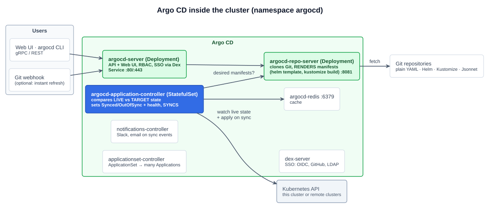
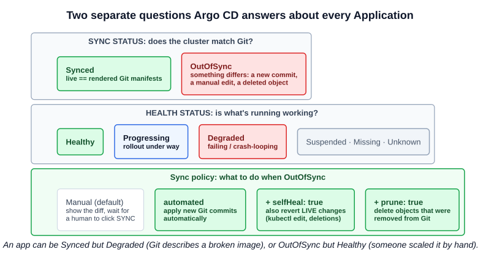
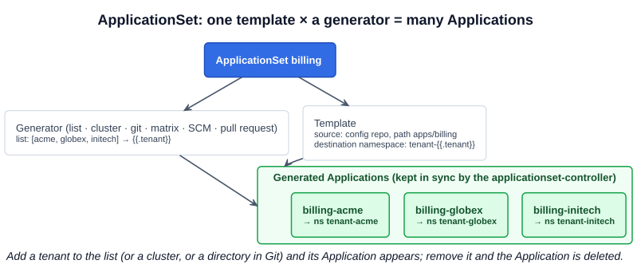

# 02 — Argo CD

> **Argo CD is a declarative, GitOps continuous delivery tool for Kubernetes.** Application definitions, configurations, and environments should be declarative and version controlled; application deployment and lifecycle management should be automated, auditable, and easy to understand. — [argo-cd.readthedocs.io](https://argo-cd.readthedocs.io/en/stable/)

Argo CD is the **GitOps agent** from [07-01](01-application-delivery-and-gitops.md) made concrete. It runs **in the cluster**, watches Git repositories, **compares** what they describe with what's running, shows the difference, and **syncs** the cluster to Git, either on request or automatically.

- Part of the **Argo** project: **CNCF Incubating March 2020, Graduated December 2022**. The project began at Applatix, and Argo CD was created at **Intuit** (2018), which acquired Applatix.
- The lecture used **v2.9.3**. Argo CD **3.0** arrived in 2025 (v3.5 by late 2026). The install command and concepts below are unchanged.
- The name has nothing to do with the 2012 film from the lecture's slide (that was the instructor's joke). The project's mascot is an octopus.

---

## 1. Architecture



The lecture's `kubectl -n argocd get svc` output maps to these components:

| Component | Kind | Port(s) | Job |
|---|---|---|---|
| **argocd-server** | Deployment | **80 / 443** | **API server and Web UI**: what the UI and the `argocd` CLI talk to. Handles RBAC, SSO and Git webhooks |
| **argocd-repo-server** | Deployment | 8081 (metrics 8084) | **Clones Git repos and renders manifests**: plain YAML, **Helm** (`helm template`), **Kustomize** (`kustomize build`), Jsonnet or plugins. Never talks to the cluster |
| **argocd-application-controller** | **StatefulSet** | metrics 8082 | **The reconciler.** Continuously compares **live** state with **target** state from the repo-server, sets **sync and health status**, and performs **syncs** |
| **argocd-redis** | Deployment | 6379 | Cache for rendered manifests and cluster state |
| **argocd-dex-server** | Deployment | 5556, 5557, 5558 | **SSO**: OIDC, GitHub, GitLab, LDAP, SAML |
| **argocd-applicationset-controller** | Deployment | 7000, 8080 | Turns **ApplicationSets** into Applications (section 5) |
| **argocd-notifications-controller** | Deployment | metrics 9001 | Sends notifications on sync and health events (Slack, email, webhooks) |

The install also creates **NetworkPolicies** for each component ([05-10](../05-kubernetes-deep-dive/10-network-policies.md)) and the CRDs below.

### The CRDs (API group `argoproj.io`)

| CRD | Describes |
|---|---|
| **Application** | **One app**: a **source** (Git repo, path, revision; or a Helm chart) and a **destination** (cluster + namespace), plus a **sync policy** |
| **AppProject** | A tenant boundary: which repos, destination clusters and namespaces, and resource kinds its Applications may use. Every Application belongs to one (`default` exists out of the box) |
| **ApplicationSet** | A **template** plus a **generator** that produces **many Applications** |

```yaml
apiVersion: argoproj.io/v1alpha1
kind: Application
metadata:
  name: guestbook
  namespace: argocd                       # Applications live in Argo CD's namespace
  finalizers:
    - resources-finalizer.argocd.argoproj.io   # deleting the Application deletes the app's resources too
spec:
  project: default
  source:
    repoURL: https://github.com/argoproj/argocd-example-apps.git
    targetRevision: HEAD                  # branch, tag or commit
    path: guestbook                       # directory of YAML (or a Helm chart / Kustomize overlay)
  destination:
    server: https://kubernetes.default.svc   # = the cluster Argo CD runs in
    namespace: guestbook
  syncPolicy:
    automated:                            # sync automatically when Git changes ...
      prune: true                         # ... delete objects removed from Git
      selfHeal: true                      # ... and revert changes made directly in the cluster
    syncOptions:
      - CreateNamespace=true              # create the destination namespace if missing
```

---

## 2. Sync status, health status, sync policy



Argo CD reports **two independent statuses** for every Application. The lecture's UI shows both: *APP HEALTH Progressing*, *SYNC STATUS Synced to HEAD (45fc08d)*.

| Status | Values | Question it answers |
|---|---|---|
| **Sync status** | **Synced**, **OutOfSync** | Does the **live state match Git**? |
| **Health status** | **Healthy**, **Progressing**, **Degraded**, **Suspended**, **Missing**, **Unknown** | Is what's running **working**? (Deployment available, Pods ready, PVC bound) |

### Sync policy: what happens when it's OutOfSync

| Setting | Default | Effect |
|---|---|---|
| **Manual sync** | **Yes** | Argo CD shows the **diff** and waits for someone to press **SYNC** (or run `argocd app sync`) |
| **`automated`** | off | **Syncs automatically** when the rendered manifests change, i.e. on a new commit. **This is what makes Argo CD continuous deployment.** |
| **`automated.selfHeal`** | off | Also syncs when the **live** cluster drifts: `kubectl edit`, `kubectl scale`, **deleted objects**. That's what brought back the lecture's deleted namespace ([07-01](01-application-delivery-and-gitops.md)) |
| **`automated.prune`** | off | **Deletes** live objects that were **removed from Git**. Off by default as a safety net, so removed resources stay until you prune |
| `syncOptions: CreateNamespace=true` | off | Creates the destination namespace during sync |

**How fast?** Argo CD **polls Git** every **120 s plus up to 60 s jitter** (so at most 3 minutes; `timeout.reconciliation` in `argocd-cm`). A **Git webhook** makes it immediate. **Live-state changes are seen at once**, because the controller **watches** the cluster, and self-heal re-syncs after a **5-second** timeout.

### Ordering: waves and hooks

A sync can be more than one big `kubectl apply`:

- **Sync waves:** the annotation `argocd.argoproj.io/sync-wave: "-1"` applies lower-numbered waves first, so a namespace, CRD or database can come up before the app.
- **Resource hooks:** `argocd.argoproj.io/hook: PreSync | Sync | PostSync | SyncFail` on a Job runs it at that phase: a DB migration before the sync, a smoke test after it, a notification on failure.

### Rollback

**HISTORY AND ROLLBACK** in the UI, or `argocd app rollback <app> <id>`, redeploys an earlier synced revision. **With automated sync on, the next sync reverts it to Git's HEAD again**, so in real GitOps you roll back by **reverting the commit in Git**.

---

## 3. Hands on: the lecture's install

```bash
kubectl create namespace argocd
kubectl apply -n argocd -f https://raw.githubusercontent.com/argoproj/argo-cd/stable/manifests/install.yaml
# → ServiceAccounts, CRDs, ConfigMaps, Services, Deployments, the application-controller StatefulSet, NetworkPolicies

# Lab-only: serve the UI over plain HTTP so the lab's reverse proxy (or a simple port-forward) works
kubectl -n argocd patch configmap argocd-cmd-params-cm --type merge -p '{"data":{"server.insecure":"true"}}'
kubectl -n argocd rollout restart deployment/argocd-server
watch --difference kubectl get all -n argocd

# The initial admin password: auto-generated into a Secret
kubectl -n argocd get secret argocd-initial-admin-secret -o jsonpath="{.data.password}" | base64 -d; echo
#   or, with the CLI:   argocd admin initial-password -n argocd

kubectl -n argocd get svc                                      # argocd-server  ClusterIP  80/TCP,443/TCP
kubectl -n argocd port-forward svc/argocd-server 8080:80       # http://localhost:8080  user: admin
```

- **`server.insecure: "true"`**: argocd-server normally serves **HTTPS with a self-signed certificate** and redirects HTTP. Insecure mode turns TLS off. That's fine for a lab, or **behind an Ingress or proxy that terminates TLS** ([05-11](../05-kubernetes-deep-dive/11-ingress.md)). Don't expose it as-is.
- **The initial admin password** lives in **`argocd-initial-admin-secret`** (key `password`) in the `argocd` namespace. Change it (`argocd account update-password`), then **delete that Secret**, as the docs recommend. With SSO you'd disable the local admin entirely.

### Create an application

In the UI (**+ NEW APP**): name, project `default`, **sync policy Automatic** (tick **Prune** and **Self Heal**), repository URL, path, destination `https://kubernetes.default.svc` and a namespace. Or with the CLI:

```bash
argocd login localhost:8080 --username admin --password <pw> --insecure
argocd app create guestbook \
  --repo https://github.com/argoproj/argocd-example-apps.git --path guestbook \
  --dest-server https://kubernetes.default.svc --dest-namespace guestbook \
  --sync-policy automated --auto-prune --self-heal --sync-option CreateNamespace=true
argocd app list
argocd app get guestbook          # sync + health status, resource tree
argocd app diff guestbook         # live vs Git
argocd app sync guestbook         # manual sync
argocd app history guestbook
```

Or **declaratively**, the GitOps way: `kubectl apply -f` an `Application` manifest (above). The lecture's app was **WordPress + MySQL**: two Deployments, two Services, two PVCs and a Secret, all in the resource tree.

### Watch it heal

```bash
kubectl -n guestbook scale deploy guestbook-ui --replicas=5   # drift → OutOfSync → self-heal sets it back
kubectl -n guestbook delete svc guestbook-ui                  # deleted → Missing → recreated
kubectl delete namespace guestbook                            # the lecture's demo: everything comes back
argocd app get guestbook                                      # watch the status flip and recover
```

Runnable manifests: [`examples/argocd/`](../../examples/argocd/).

---

## 4. Beyond one app

- **Multi-cluster.** One Argo CD can deploy to **many clusters**: `argocd cluster add <kube-context>` registers a cluster (as a Secret), and Applications target it by `destination.server`. It's a **hub-and-spoke**, **centralized** model, which is the contrast with Flux's per-cluster model in the further-study page ([07-04](04-flux-and-the-gitops-toolkit.md)).
- **App of apps.** An Application whose path contains **other Application manifests**. Syncing it creates them all, so you bootstrap a whole cluster from one Application.
- **AppProjects** restrict what a team's Applications may deploy, and where: the multi-tenancy boundary.
- **Deleting an Application** deletes its Kubernetes resources only if it carries the **`resources-finalizer.argocd.argoproj.io`** finalizer ([05-19](../05-kubernetes-deep-dive/19-garbage-collection.md)), which the UI and CLI delete add for you. Without it, `kubectl delete application` removes just the Application and leaves the app running, unmanaged.

---

## 5. ApplicationSet: one definition, many Applications

A quiz scenario: *a DevOps team uses Argo CD for a multi-tenant SaaS platform and must deploy a billing microservice to **every customer namespace automatically**, including new customers.* Writing one Application per tenant by hand doesn't scale. **ApplicationSet** is the answer.



An **ApplicationSet** = a **template** for an Application + one or more **generators** that produce the parameters. The **applicationset-controller** creates, updates and deletes the Applications to match.

| Generator | Produces one Application per ... | Use |
|---|---|---|
| **List** | item in a fixed list | Tenants, environments |
| **Cluster** | cluster registered in Argo CD (filter by labels) | Deploy an add-on to **every cluster** |
| **Git** | directory or file in a repo | "Every folder under `apps/` is an app" |
| **Matrix / Merge** | combination of two generators | Every app × every cluster |
| **SCM Provider / Pull Request** | repository in an org, or **open pull request** | Preview environments per PR |
| Cluster Decision Resource, Plugin | external decision / custom logic | Advanced |

```yaml
apiVersion: argoproj.io/v1alpha1
kind: ApplicationSet
metadata:
  name: billing
  namespace: argocd
spec:
  goTemplate: true
  generators:
    - list:
        elements:
          - tenant: acme
          - tenant: globex
          - tenant: initech          # add a customer = add a line
  template:
    metadata:
      name: 'billing-{{.tenant}}'
    spec:
      project: default
      source:
        repoURL: https://github.com/example/saas-config.git
        targetRevision: main
        path: apps/billing
      destination:
        server: https://kubernetes.default.svc
        namespace: 'tenant-{{.tenant}}'
      syncPolicy:
        automated: {prune: true, selfHeal: true}
        syncOptions: [CreateNamespace=true]
```

---

## Exam angle

- **Argo CD = declarative, GitOps continuous delivery for Kubernetes.** It runs **in the cluster**, **pulls** from Git, compares **live vs desired**, and syncs. Argo is **CNCF Graduated** (Dec 2022).
- **Continuous deployment with Argo CD = an Application with an `automated` sync policy.** Add **`selfHeal`** to revert manual drift and **`prune`** to delete what was removed from Git. Both are off by default; manual sync is the default.
- **Two statuses:** **sync** (**Synced / OutOfSync**: does live match Git?) and **health** (**Healthy / Progressing / Degraded / Suspended / Missing / Unknown**).
- **Components:** **argocd-server** (API + UI), **repo-server** (clones and renders Helm/Kustomize/YAML), **application-controller** (**StatefulSet**; reconciles), plus Redis, Dex (SSO), the ApplicationSet controller and the notifications controller.
- **Initial admin password:** `kubectl -n argocd get secret argocd-initial-admin-secret -o jsonpath="{.data.password}" | base64 -d` (or `argocd admin initial-password`). The user is `admin`.
- **Deploying the same app to many namespaces or clusters automatically = ApplicationSet** (list, cluster, git, matrix generators). Not one hand-written Application each, and not a CI loop.

## References

- [Argo CD overview](https://argo-cd.readthedocs.io/en/stable/) — what it is, how it works, features
- [Architecture](https://argo-cd.readthedocs.io/en/stable/operator-manual/architecture/) — API server, repository server, application controller
- [Automated sync policy](https://argo-cd.readthedocs.io/en/stable/user-guide/auto_sync/) — automated, prune, selfHeal, polling and timeouts
- [ApplicationSet](https://argo-cd.readthedocs.io/en/stable/operator-manual/applicationset/) — generators and templates
