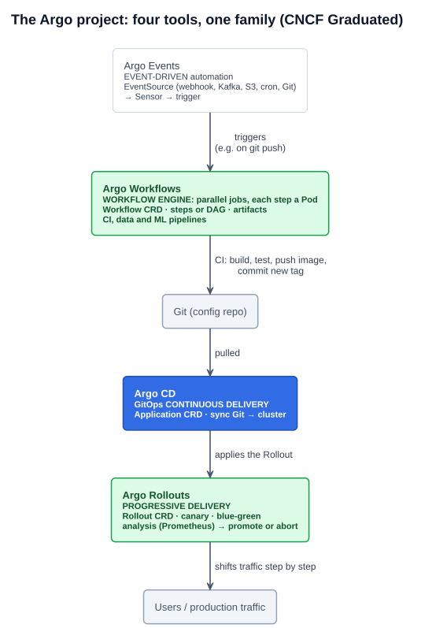
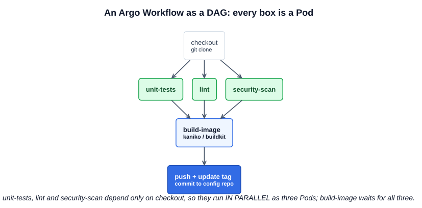

# 03 — Argo Workflows and the Argo family

> **Argo Workflows is an open source container-native workflow engine for orchestrating parallel jobs on Kubernetes.** It's implemented as a Kubernetes CRD: you define workflows where **each step is a container**, as a sequence of steps or as a **directed acyclic graph (DAG)** of tasks. — [argoproj.github.io/workflows](https://argoproj.github.io/workflows/)

The study tips: know that **Argo can be further used through Argo Workflows**, to manage complex, multi-step processes beyond what a single sync does.

**A correction to the further-study page.** It calls the tool *"Argo CD Workflows"*. There's no such product. **Argo Workflows** is a **separate tool** in the Argo project, with its own CRD, controller and UI. **Argo CD doesn't run workflows**: it syncs Git to the cluster. The page's points (sequential and parallel steps, CI and CD in one pipeline, testing and approval stages) describe **Argo Workflows used alongside Argo CD**. Argo CD's own multi-step tools are the **sync waves and hooks** from [07-02](02-argo-cd.md).

---

## 1. The Argo family



The **Argo** project (**CNCF Graduated, December 2022**) is four independent tools that are often used together:

| Tool | Category | One line | Key CRDs |
|---|---|---|---|
| **Argo CD** | **GitOps continuous delivery** | Syncs the cluster to what's in Git ([07-02](02-argo-cd.md)) | `Application`, `AppProject`, `ApplicationSet` |
| **Argo Workflows** | **Workflow engine** | Runs multi-step jobs, **each step a Pod**, in sequence or **in parallel** | `Workflow`, `WorkflowTemplate`, `ClusterWorkflowTemplate`, `CronWorkflow` |
| **Argo Rollouts** | **Progressive delivery** | **Blue-green** and **canary** deployments with automated analysis and promotion or rollback | `Rollout`, `AnalysisTemplate`, `AnalysisRun`, `Experiment` |
| **Argo Events** | **Event-driven automation** | Listens for events (webhooks, Git pushes, Kafka, S3, cron, ...) and **triggers** Workflows, Kubernetes objects or HTTP calls | `EventSource`, `Sensor`, `EventBus` |

**"Within the Argo project, which component is responsible for X?"** comes up on the exam:

| X | Answer |
|---|---|
| Keeping the cluster in sync with Git | **Argo CD** |
| Orchestrating **parallel jobs** / multi-step pipelines (CI, ML, data) | **Argo Workflows** |
| Canary or blue-green releases with metric-based promotion | **Argo Rollouts** |
| Reacting to events and triggering automation | **Argo Events** |

---

## 2. Argo Workflows

### How it works

- You submit a **`Workflow`** object. The **workflow-controller** creates **one Pod per step**. Kubernetes schedules them, so a workflow scales across the cluster like any other workload.
- **Steps** run as a list of stages: each stage runs after the previous one, and the items inside a stage run **in parallel**.
- **DAG** templates declare each task's **dependencies**. Anything whose dependencies are met runs **in parallel**, automatically.
- **Parameters** pass values between steps. **Artifacts** pass files, stored in S3, MinIO, GCS and so on.
- Also: conditionals (`when`), loops (`withItems`, `withParam`), retries, timeouts, exit handlers, suspend steps for **manual approval**.
- **Reuse:** `WorkflowTemplate` (a library of steps in a namespace), `ClusterWorkflowTemplate` (cluster-wide), **`CronWorkflow`** (scheduled runs, like a CronJob for whole pipelines).
- A **UI and API server** (`argo-server`, port **2746**) and an **`argo` CLI**.



```yaml
apiVersion: argoproj.io/v1alpha1
kind: Workflow
metadata:
  generateName: ci-pipeline-
spec:
  entrypoint: pipeline
  templates:
    - name: pipeline
      dag:
        tasks:
          - name: checkout
            template: run
            arguments: {parameters: [{name: msg, value: "git clone"}]}
          - name: unit-tests
            dependencies: [checkout]               # these three only need checkout,
            template: run                          # so they run in parallel
            arguments: {parameters: [{name: msg, value: "go test ./..."}]}
          - name: lint
            dependencies: [checkout]
            template: run
            arguments: {parameters: [{name: msg, value: "golangci-lint run"}]}
          - name: security-scan
            dependencies: [checkout]
            template: run
            arguments: {parameters: [{name: msg, value: "trivy fs ."}]}
          - name: build-image
            dependencies: [unit-tests, lint, security-scan]   # waits for all three
            template: run
            arguments: {parameters: [{name: msg, value: "build and push image"}]}
    - name: run                                    # one reusable step: a container
      inputs:
        parameters: [{name: msg}]
      container:
        image: busybox
        command: [sh, -c]
        args: ["echo '{{inputs.parameters.msg}}'; sleep 5"]
```

### Where it's used

- **CI pipelines** on Kubernetes: build, test and scan, then commit the new image tag for Argo CD to deploy.
- **Machine learning**: **Kubeflow Pipelines** runs on Argo Workflows ([02-06](../02-cloud-native-architecture/06-cloud-native-personas.md)).
- **Data processing and batch**: fan out over thousands of inputs in parallel, then fan the results back in.
- **Infrastructure automation**: multi-step operational runbooks.

### Workflows vs a Kubernetes Job

| | **Job** ([04-09](../04-kubernetes-fundamentals/09-jobs-and-cronjobs.md)) | **Argo Workflow** |
|---|---|---|
| Shape | One Pod template, run N times | Many **different** steps with **dependencies** |
| Ordering | None between Jobs | Sequences and DAGs |
| Passing data | Not built in | Parameters and artifacts |
| Scheduling | CronJob | CronWorkflow |

---

## 3. Argo Rollouts: progressive delivery

A Kubernetes Deployment's rolling update ([04-05](../04-kubernetes-fundamentals/05-deployments-and-replicasets.md)) replaces Pods gradually, but it can't hold at "10% of traffic", check metrics, and decide. **Argo Rollouts** can:

- A **`Rollout`** replaces the Deployment (same Pod template), plus a **strategy**:
  - **Canary**: steps such as `setWeight: 10` → `pause: {duration: 10m}` → `setWeight: 50` → ... Traffic is split precisely through an Ingress controller, a **service mesh** ([05-23](../05-kubernetes-deep-dive/23-service-meshes.md)) or the **Gateway API** ([05-12](../05-kubernetes-deep-dive/12-gateway-api.md)).
  - **Blue-green**: the new version runs beside the old behind a **preview** Service, and the **active** Service switches over when it's promoted.
- An **`AnalysisTemplate`** queries **Prometheus** (or Datadog, a Job, a webhook) during the rollout: error rate below 1%? p95 under 200 ms? **Pass → continue. Fail → automatic rollback.**

Argo CD deploys the `Rollout` from Git. Argo Rollouts then decides **how fast** the new version takes traffic.

---

## 4. Argo Events

**Argo Events** is an event-based dependency manager for Kubernetes. An **`EventSource`** connects to something (a GitHub webhook, a Kafka topic, an S3 bucket, a schedule). A **`Sensor`** defines which events (and combinations of events) **trigger** what: submit a Workflow, create a Kubernetes object, call a URL. A typical chain is **git push → Argo Events → Argo Workflows (CI) → commit → Argo CD (CD) → Argo Rollouts (canary)**.

---

## 5. Hands on: Argo Workflows quick start

```bash
kubectl create namespace argo
kubectl apply -n argo -f https://github.com/argoproj/argo-workflows/releases/download/v4.1.5/quick-start-minimal.yaml
kubectl -n argo get pods                                   # workflow-controller, argo-server

# CLI: download "argo" from the GitHub releases page, then:
argo submit -n argo --watch examples/argo-workflows/parallel-dag.yaml   # from this repo
argo list -n argo
argo get -n argo @latest                                   # the DAG, each node's status and duration
argo logs -n argo @latest
kubectl -n argo get pods                                   # one Pod per step; the three parallel ones overlap

kubectl -n argo port-forward svc/argo-server 2746:2746     # UI at https://localhost:2746 (self-signed)
```

Quick-start manifests are for learning only: they use minimal auth and aren't hardened. The workflow above is in [`examples/argo-workflows/`](../../examples/argo-workflows/).

---

## Exam angle

- **Argo Workflows = a container-native workflow engine for orchestrating parallel jobs on Kubernetes.** **Each step is a Pod.** Steps or **DAG**. It's the answer to "which engine orchestrates parallel jobs / multi-step pipelines on Kubernetes".
- **It's separate from Argo CD.** CD syncs Git to the cluster, Workflows runs pipelines, and they're commonly combined (Workflows for CI, Argo CD for CD). The course's "Argo CD Workflows" means this pairing.
- **The Argo family:** **CD** (GitOps delivery), **Workflows** (workflow engine), **Rollouts** (canary and blue-green progressive delivery with analysis), **Events** (event-driven triggers). The whole **Argo** project is **CNCF Graduated**.
- **Argo Rollouts** = progressive delivery: a `Rollout` CRD with canary or blue-green strategies and **automated analysis** (often Prometheus) that promotes or rolls back.

## References

- [Argo Workflows](https://argoproj.github.io/workflows/) — overview and use cases
- [Argo Workflows documentation](https://argo-workflows.readthedocs.io/en/latest/) — core concepts, DAG and steps templates, quick start
- [Argo Rollouts](https://argoproj.github.io/rollouts/) — blue-green, canary, analysis
- [Argo Events](https://argoproj.github.io/events/) — event sources, sensors, triggers
