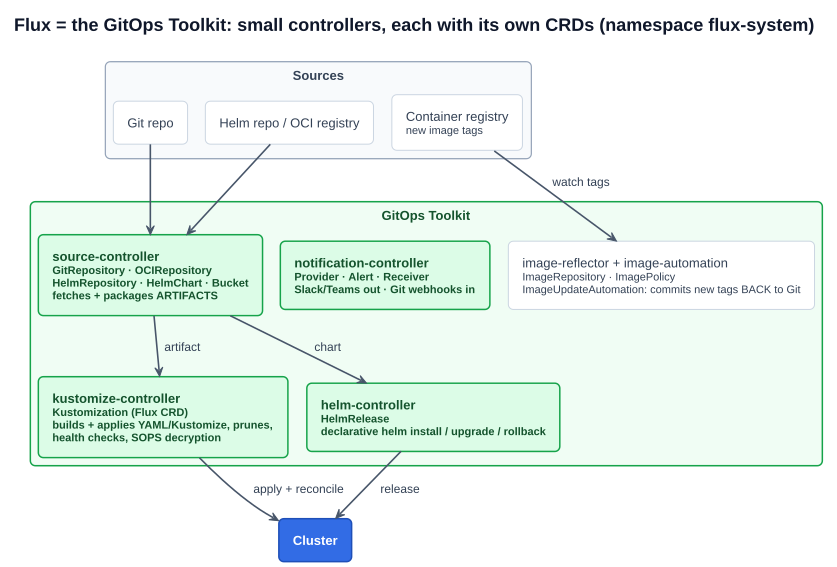
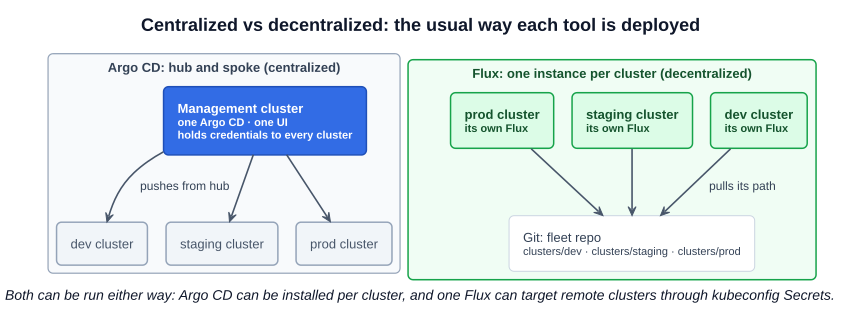

# 04 — Flux and the GitOps Toolkit

> **Flux is a tool for keeping Kubernetes clusters in sync with sources of configuration (like Git repositories), and automating updates to configuration when there is new code to deploy.** — [fluxcd.io](https://fluxcd.io/flux/)

The study tips: be aware of **Flux as an alternative to Argo CD**, and understand **the GitOps Toolkit that Flux uses**. Flux is the other **CNCF Graduated** GitOps tool, and the one GitOps itself grew out of.

- Created by **Weaveworks** in **2016**. Weaveworks also **coined "GitOps" in 2017**.
- **CNCF Sandbox July 2019 → Incubating March 2021 → Graduated November 2022.**
- **Flux v2** is a rewrite as the **GitOps Toolkit**: a set of composable controllers (v2.0 GA in 2023; v2.9 by late 2026). Weaveworks closed in **2024**, and Flux continues as a vendor-neutral CNCF project.

---

## 1. The GitOps Toolkit

Where Argo CD is one application with several components, **Flux is a set of independent controllers, each owning its own CRDs**. You use only the ones you need, and they cooperate through the objects they produce. That modularity is what the further-study page means by *"composable APIs and specialised tools"*.



| Controller | CRDs | Job |
|---|---|---|
| **source-controller** | `GitRepository`, `OCIRepository`, `HelmRepository`, `HelmChart`, `Bucket` | **Acquires sources**: clones Git, pulls OCI artifacts and Helm charts, polls S3 buckets on an interval, verifies signatures, and packages each revision as an **artifact** for the other controllers |
| **kustomize-controller** | **`Kustomization`** | **Applies manifests** from a source using **Kustomize** (plain YAML works too), on an interval: server-side apply, **pruning** of removed objects, **health checks**, dependencies between Kustomizations, **SOPS** decryption |
| **helm-controller** | **`HelmRelease`** | **Declarative Helm**: install, upgrade, test, **rollback** on failure, uninstall, all driven by a YAML object instead of `helm` commands ([05-21](../05-kubernetes-deep-dive/21-helm.md)) |
| **notification-controller** | `Provider`, `Alert`, `Receiver` | **Outbound** events to Slack, Teams, GitHub commit status and so on. **Inbound** webhooks (`Receiver`) from GitHub or GitLab trigger an immediate reconcile |
| image-reflector-controller + image-automation-controller | `ImageRepository`, `ImagePolicy`, `ImageUpdateAutomation` | Scan a registry for new tags, pick one by policy (SemVer range, regex), and **commit the new tag back to Git**, so the image update itself goes through GitOps |

**Name collision to watch for:** Flux's **`Kustomization`** (API group `kustomize.toolkit.fluxcd.io`) is a **Flux CRD** that says "apply this path from this source every 10 minutes". It isn't Kustomize's `kustomization.yaml` (`kustomize.config.k8s.io`, [05-22](../05-kubernetes-deep-dive/22-kustomize.md)), though it **runs** Kustomize on that path.

```yaml
# 1. WHERE the config lives (source-controller)
apiVersion: source.toolkit.fluxcd.io/v1
kind: GitRepository
metadata:
  name: podinfo
  namespace: flux-system
spec:
  interval: 1m                          # how often to check Git
  url: https://github.com/stefanprodan/podinfo
  ref:
    branch: master
---
# 2. WHAT to apply from it, and how (kustomize-controller)
apiVersion: kustomize.toolkit.fluxcd.io/v1
kind: Kustomization
metadata:
  name: podinfo
  namespace: flux-system
spec:
  interval: 10m                         # re-apply and correct drift at least this often
  sourceRef:
    kind: GitRepository
    name: podinfo
  path: ./kustomize                     # runs kustomize build here
  prune: true                           # delete objects removed from Git
  targetNamespace: default
  wait: true                            # health-check what was applied
```

```yaml
# Helm, the Flux way (source-controller + helm-controller)
apiVersion: source.toolkit.fluxcd.io/v1
kind: HelmRepository
metadata:
  name: prometheus-community
  namespace: flux-system
spec:
  interval: 1h
  url: https://prometheus-community.github.io/helm-charts
---
apiVersion: helm.toolkit.fluxcd.io/v2
kind: HelmRelease
metadata:
  name: kube-prometheus-stack
  namespace: monitoring
spec:
  interval: 30m
  chart:
    spec:
      chart: kube-prometheus-stack
      version: "92.x"                   # a SemVer range: upgrades within major 92
      sourceRef:
        kind: HelmRepository
        name: prometheus-community
        namespace: flux-system
  values:                               # what you'd pass with -f values.yaml
    grafana:
      enabled: true
```

---

## 2. How Flux reconciles

- **Pull-based, from day one.** The further-study page's point: Flux *"has always traditionally used a pull-based approach and was one of the first tools in the Kubernetes ecosystem to introduce this capability as one of its core features"*. It **automatically synchronizes** on every object's **`interval`**, with no "manual sync" default. That's why many consider Flux the **"textbook" choice for continuous synchronization**, even though Argo CD can do the same with an automated sync policy.
- **Each object reconciles on its own interval.** A GitRepository is checked every `interval` for new commits. A Kustomization re-applies at least every `interval`, which **corrects drift** (a `kubectl edit` is overwritten on the next run). A notification `Receiver` webhook triggers a reconcile immediately.
- **Status lives in the objects**, as Kubernetes conditions: `kubectl get kustomizations -A` shows `READY True/False` and the applied revision. There's **no built-in web UI**. The `flux` CLI is the main interface, with optional third-party UIs (Headlamp's Flux plugin, Capacitor).
- **Suspend and resume:** `flux suspend kustomization <name>` pauses reconciliation, for example during an incident.

---

## 3. Bootstrap: Flux manages itself

`flux bootstrap` installs Flux **and** commits Flux's own manifests to a Git repo, then points Flux at that repo. From then on **Flux is managed by Flux**, and upgrading it is a commit.

```bash
# Prerequisites: the flux CLI, a GitHub personal access token in GITHUB_TOKEN
brew install fluxcd/tap/flux                  # or: curl -s https://fluxcd.io/install.sh | sudo bash
flux check --pre                              # is the cluster compatible?

export GITHUB_TOKEN=<token> GITHUB_USER=<you>
flux bootstrap github \
  --owner=$GITHUB_USER \
  --repository=fleet-infra \
  --branch=main \
  --path=./clusters/my-cluster \
  --personal
# → creates the repo if needed, commits clusters/my-cluster/flux-system/, installs the controllers
#   in namespace flux-system, and creates a GitRepository + Kustomization that watch that path

kubectl -n flux-system get pods               # source-, kustomize-, helm-, notification-controller
```

A typical **fleet repo**: one directory per cluster, sharing common bases.

```
fleet-infra/
├── clusters/
│   ├── homelab/            # Flux on the homelab cluster watches this path
│   │   ├── flux-system/    # written by bootstrap
│   │   ├── infrastructure.yaml   # Kustomization → ../../infrastructure
│   │   └── apps.yaml             # Kustomization → ../../apps/homelab (dependsOn: infrastructure)
│   └── hetzner/
├── infrastructure/         # ingress controller, cert-manager, monitoring (HelmReleases)
└── apps/
    ├── base/               # Kustomize bases
    └── homelab/            # overlays
```

### The everyday CLI

```bash
flux get sources git -A                       # GitRepositories and their latest revision
flux get kustomizations -A                    # READY, revision, message
flux get helmreleases -A
flux reconcile source git flux-system         # pull now instead of waiting for the interval
flux reconcile kustomization apps --with-source
flux suspend kustomization apps ; flux resume kustomization apps
flux logs --level=error
flux tree kustomization flux-system           # every object a Kustomization manages
flux create source git podinfo --url=https://github.com/stefanprodan/podinfo --branch=master --interval=1m --export > podinfo-source.yaml
flux uninstall                                # remove Flux (keeps the workloads)
```

Runnable manifests: [`examples/flux/`](../../examples/flux/).

---

## 4. Argo CD vs Flux



| | **Argo CD** ([07-02](02-argo-cd.md)) | **Flux** |
|---|---|---|
| CNCF | **Graduated** (Argo project, Dec 2022) | **Graduated** (Nov 2022) |
| Origin | Intuit (2018) | Weaveworks (2016); coined "GitOps" |
| Architecture | **One application** with components: API server, repo-server, application-controller | **GitOps Toolkit**: **independent controllers**, composable |
| Typical topology | **Centralized**: one Argo CD (hub) can manage **many clusters**, with one UI | **Decentralized**: **one Flux per cluster**, each pulling its own path, scaling naturally to large fleets |
| Default sync | **Manual**; `automated` is opt-in (plus `selfHeal`, `prune`) | **Automatic** on every interval. Continuous sync is the core design |
| UI | **Rich built-in Web UI** (resource tree, diff, history) | **No built-in UI**; CLI plus Kubernetes status, optional add-on UIs |
| Unit of deployment | `Application` / `ApplicationSet` | `Kustomization` / `HelmRelease` (+ sources) |
| Helm | Renders the chart with `helm template` and applies the manifests (no Helm release) | **helm-controller** performs **real Helm releases** (`helm list` shows them) |
| Multi-tenancy | AppProjects + Argo CD's own RBAC and SSO | **Kubernetes RBAC** (service account impersonation per Kustomization) |
| Progressive delivery | **Argo Rollouts** | **Flagger** (part of the Flux project) |
| Image updates | Argo CD Image Updater (add-on) | **Built in**: image-reflector + image-automation controllers |

**Which to choose:** both are mature, graduated, pull-based and widely used. Argo CD suits teams that want a **central control plane and a UI** for developers. Flux suits teams that want **lightweight, Kubernetes-native building blocks**, one per cluster, driven entirely from Git and the CLI.

**On the further-study page's claims:** "Argo CD is centralized, Flux decentralized" describes the **usual deployment model**, not a hard limit. Argo CD can run per cluster, and Flux can target remote clusters. And "Flux for synchronized cluster changes" is about **defaults**: Argo CD with `automated` + `selfHeal` reconciles continuously too.

---

## Exam angle

- **Flux = a CNCF Graduated GitOps tool** that keeps clusters in sync with Git (and OCI, Helm, S3 sources), **pull-based**, reconciling **automatically on an interval**. It's the textbook continuous-synchronization tool and the main **alternative to Argo CD**.
- **Which GitOps tool uses the GitOps Toolkit?** **Flux.** The Toolkit's controllers: **source-controller** (fetches Git/OCI/Helm/Bucket sources), **kustomize-controller** (`Kustomization`: applies manifests via Kustomize), **helm-controller** (`HelmRelease`: declarative Helm releases), **notification-controller** (alerts out, webhooks in), plus the image automation controllers.
- **Argo CD vs Flux:** Argo CD = one application, **centralized** hub, **web UI**, manual sync by default. Flux = **modular controllers**, typically **one per cluster** (decentralized), automatic sync, no built-in UI. Both are pull-based and both are Graduated.
- **`flux bootstrap`** installs Flux and makes it **manage itself from Git**.
- **Distractor:** Flux's `Kustomization` CRD isn't Kustomize's `kustomization.yaml`, and `HelmRelease` isn't a Helm chart.

## References

- [Flux documentation](https://fluxcd.io/flux/) — what Flux is and how it works
- [Flux components (GitOps Toolkit)](https://fluxcd.io/flux/components/) — source, kustomize, helm, notification and image controllers
- [Flux core concepts](https://fluxcd.io/flux/concepts/) — sources, reconciliation, Kustomization, bootstrap
- [Get started with Flux](https://fluxcd.io/flux/get-started/) — `flux bootstrap github` walkthrough
